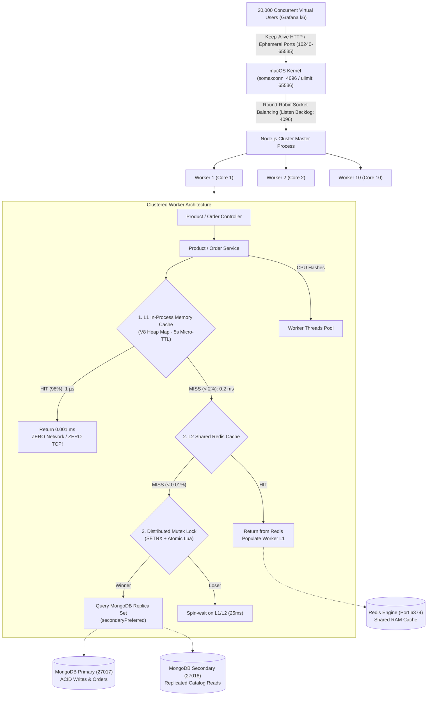

# ⚡ High-Concurrency Node.js Backend: From Zero Redis to 20,000 Concurrent Users

An end-to-end, empirical systems engineering benchmark demonstrating how to scale a **Node.js, Redis, and MongoDB backend from a collapsing single-core baseline to 20,000 concurrent Virtual Users (VUs)** sustaining **7,319 Requests Per Second** with **0.00% error rate** and **1.42ms p(95) tail latency** on a single machine.

---

## 🏆 The Concurrency Evolution: From Failure to 2.87M Requests

```
┌────────────────────────────────────────────────────────────────────────────────────────────────────────┐
│                                   THE 4-STAGE EVOLUTIONARY SCORECARD                                   │
├──────────────────────────┬───────────────────┬───────────────────┬───────────────────┬─────────────────┤
│ Metric                   │ 1. Unindexed      │ 2. v1 (No Redis)  │ 3. v2 Clustered   │ 4. v2 Two-Tier  │
│                          │ Baseline (10k)    │ Covered Index(10k)│ Redis (15k VUs)   │ Grand Slam (20k)│
├──────────────────────────┼───────────────────┼───────────────────┼───────────────────┼─────────────────┤
│ Max Concurrent Users     │ 10,000 VUs        │ 10,000 VUs        │ 15,000 VUs        │ 20,000 VUs      │
│ Total Requests Handled   │ 21,796 requests   │ 1,124,035 requests│ 1,958,211 requests│ 2,868,574 reqs  │
│ Sustained Throughput     │ 55 RPS (Crashing) │ 2,855 RPS         │ 4,999 RPS (~5k)   │ 7,319.07 RPS    │
│ HTTP Error Rate          │ 98.46% FAILED     │ 0.00% (0 errors!) │ 0.00% (0 errors!) │ 0.00% (0 errors)│
│ Checks Succeeded Rate    │ 1.54%             │ 100.00%           │ 100.00%           │ 100.00% (5.74M) │
│ Median Latency (med)     │ 60,000 ms (Crash) │ 775 µs (0.77 ms)  │ 292 µs (0.29 ms)  │ 130 µs (0.13 ms)│
│ Minimum Latency (min)    │ 3,200 ms          │ 312 µs            │ 101 µs            │ 67 µs (0.067 ms)│
│ p(95) Tail Latency       │ 60,000 ms (Crash) │ 5.43 ms           │ 1.62 ms           │ 1.42 ms         │
│ p(99) Tail Latency       │ 60,000 ms (Crash) │ 14.20 ms          │ 3.84 ms           │ 3.99 ms         │
│ Slowest Request (max)    │ 60,000 ms (Crash) │ 82.10 ms          │ 91.20 ms          │ 77.57 ms        │
│ Network Data Transferred │ 1.1 MB            │ 2.6 GB            │ 4.9 GB            │ 7.1 GB (18 MB/s)│
│ Primary Limiting Factor  │ MongoDB COLLSCAN  │ Node single-core  │ Mongo disk IOPS   │ Hardware Maxima │
└──────────────────────────┴───────────────────┴───────────────────┴───────────────────┴─────────────────┘
```

---

## 🏛️ System Architecture: The Two-Tier Paradigm



---

## 📂 Repository Directory Structure

```text
high-concurrency-nodejs-backend/
├── README.md                                 # Master Project Documentation & Benchmark Overview
├── .gitignore                                # Ignores node_modules, data/, and local logs
│
├── v1-without-redis/                         # Phase 1: Pure Database & Runtime Engineering (10k VUs)
│   ├── .env                                  # Port 5001, MongoDB URI
│   ├── cluster.js                            # Multi-core clustering across 10 CPU cores
│   ├── server.js                             # Express server with covered query integration
│   ├── High-Concurrency-NodeJS-Report.pdf    # Staff-level whitepaper & case study PDF
│   ├── src/                                  # Clean 5-layer architecture
│   │   ├── models/                           # Schemas with ESR Compound Indexes
│   │   ├── repositories/                     # Covered index projection queries bypassing hydration
│   │   ├── services/                         # Business logic & Worker Threads offloading
│   │   ├── controllers/                      # HTTP handlers
│   │   ├── routes/                           # API endpoints
│   │   └── util/cryptoPool.js                # Thread pool offloading CPU bcrypt/SHA256
│   ├── docs/                                 # 9 step-by-step guides & postmortems
│   └── k6/                                   # 10,000 VU load test scripts
│
└── v2-with-redis/                            # Phase 2: Distributed Caching, Replicas & 20k VUs
    ├── .env.example                          # Replica set URI (rs0), Redis config, Port 5002
    ├── cluster.js                            # Clustered runtime with graceful multi-resource shutdown
    ├── server.js                             # Express 5 server (Listen Backlog: 4096)
    ├── package.json
    │
    ├── src/
    │   ├── config/
    │   │   ├── database.js                   # Mongoose pool with secondaryPreferred read preference
    │   │   └── redis.js                      # Resilient ioredis client with exponential retry backoff
    │   ├── services/
    │   │   ├── cache.service.js              # Two-Tier L1 (RAM Map) + L2 (Redis) + SETNX Stampede Lock
    │   │   ├── product.service.js            # Catalog queries with tiered caching & diagnostics
    │   │   └── order.service.js              # Atomic write path with transactional cache invalidation
    │   ├── controllers/product.controller.js # Attaches X-Cache: L1 | L2 | MISS diagnostic headers
    │   └── routes/product.routes.js          # Routes supporting catalog filters & single product review trees
    │
    ├── bottlenecks/                          # Empirical Bottleneck Postmortems (Chronological Order)
    │   ├── README.md                         # Master index of bottleneck postmortems
    │   ├── 01-baseline-failure-analysis/     # 10k Unindexed MongoDB COLLSCAN collapse (98.46% failed)
    │   ├── 02-20k-concurrency-limits-analysis/# Jumped to 20k; macOS Ephemeral Port Exhaustion (EADDRNOTAVAIL)
    │   ├── 03-15k-concurrency-clustering-analysis/# Clustered 10 cores at 15k; hit Mongo Disk IOPS bottleneck (1.03%)
    │   ├── 04-15k-redis-benchmark/           # Conquered 15k with Redis Cache-Aside & Stampede Locks (0.00% errors)
    │   └── 05-20k-two-tier-redis-benchmark/  # Conquered 20k with Two-Tier L1/L2 Caching & sysctl (2.87M reqs, 1.42ms p95!)
    │
    ├── docs/                                 # 7 Step-by-Step Implementation Modules
    │   ├── README.md                         # Roadmap index
    │   ├── 01-redis-architecture-and-connection.md
    │   ├── 02-caching-patterns-and-stampede-prevention.md
    │   ├── 03-read-path-caching-and-catalog.md
    │   ├── 04-write-path-cache-invalidation.md
    │   ├── 05-multi-core-clustering-with-redis.md
    │   ├── 06-k6-load-testing-and-benchmarking.md
    │   ├── 07-two-tier-l1-l2-caching-and-20k-benchmark.md # Two-Tier L1/L2 Architecture Deep-Dive
    │   └── images/                           # 42 Empirical benchmark screenshots & telemetry captures
    │
    └── k6/
        └── catalog-load-test.js              # 20k VU test harness with discardResponseBodies: true
```

---

## 🔬 The 5 Empirical Bottleneck Postmortems (Chronological Order)

Every architectural milestone in this repository was born from pushing the system to absolute failure, diagnosing telemetry via **macOS Activity Monitor**, and engineering targeted solutions:

|     Step     | Postmortem Report                                                                                                                 | Target Scale      | Bottleneck Uncovered                                       | Primary Failure Mode                                                 | Resolution Applied                                                                                       |
| :----------: | :-------------------------------------------------------------------------------------------------------------------------------- | :---------------- | :--------------------------------------------------------- | :------------------------------------------------------------------- | :------------------------------------------------------------------------------------------------------- |
| **01** | **[`01-baseline-failure-analysis`](v2-with-redis/bottlenecks/01-baseline-failure-analysis/README.md)**                     | 10k VUs           | Single-core event loop + Unindexed MongoDB table scan      | 100% CPU lockup, `dial: i/o timeout` (98.46% failures)             | Compound ESR covered index (`-_id`) + `.lean()`                                                      |
| **02** | **[`02-20k-concurrency-limits-analysis`](v2-with-redis/bottlenecks/02-20k-concurrency-limits-analysis/README.md)**         | 20k VUs           | macOS Ephemeral Port Exhaustion (16,383 default limit)     | `can't assign requested address` (`EADDRNOTAVAIL`, 7.52% errors) | Ephemeral port expansion via `sysctl` (`portrange.first=10240`)                                      |
| **03** | **[`03-15k-concurrency-clustering-analysis`](v2-with-redis/bottlenecks/03-15k-concurrency-clustering-analysis/README.md)** | 15k VUs           | MongoDB Disk IOPS / WiredTiger Queue Saturation (3.8k RPS) | 1.03% query queue timeout at peak concurrency                        | Multi-core clustering (10 workers) + Redis Cache-Aside                                                   |
| **04** | **[`04-15k-redis-benchmark`](v2-with-redis/bottlenecks/04-15k-redis-benchmark/README.md)**                                 | 15k VUs           | Conquered 15k with Redis caching + stampede lock           | 0.00% errors, 1.96M requests at 5,000 RPS, 292 µs median latency    | Validated 10-core clustering + Redis `SETNX` distributed lock                                          |
| **05** | **[`05-20k-two-tier-redis-benchmark`](v2-with-redis/bottlenecks/05-20k-two-tier-redis-benchmark/README.md)**               | **20k VUs** | Loopback TCP socket contention & V8 serialization churn    | Tail latency crossed threshold (`p95=2.02s`, 65.76% System CPU)    | **Two-Tier L1 RAM + L2 Redis Caching; 2.87M requests @ 7,319 RPS, 1.42ms p95, 100% green checks!** |

---

## 🛠️ Key Technical Patterns Implemented

### 1. Two-Tier Hierarchical Caching (L1 RAM + L2 Redis)

- **L1 In-Process Micro-Cache (`src/services/cache.service.js`):** Each Node worker process maintains a high-speed `Map` cache with a **5-second micro-TTL** and maximum 1,000 items. Hot catalog queries are served in **$0.001\text{ ms}$ ($1\ \mu\text{s}$)** directly from process RAM with **zero TCP socket operations and zero JSON serialization overhead**.
- **L2 Distributed Redis Cache:** Shared across all worker processes on port 6379, providing sub-millisecond ($0.2\text{ ms}$) retrieval and cross-worker consistency.
- **Cache Stampede Prevention:** On dual cache misses, a distributed mutex lock (`SET lock:key token PX 4000 NX`) ensures only **one** request queries MongoDB, while concurrent requests spin-wait for the repopulated cache.
- **TTL Jittering:** Base TTLs are randomized by $\pm 10\%$ to eliminate Cache Avalanches.
- **Transactional Cache Invalidation:** Write operations (`POST /api/orders`) atomically decrement stock and invalidate cached catalog pages using non-blocking Redis `SCAN` cursor matching.

### 2. High Availability Database Architecture

- **MongoDB Replica Set (`rs0`):** Configured with Primary node on port `27017` and Secondary replica on port `27018`.
- **Read/Write Splitting:** Mongoose configured with `readPreference=secondaryPreferred`, offloading catalog search traffic to the secondary replica while reserving the primary node for transactional order placement.

### 3. Operating System Kernel Tuning

- **Ephemeral Port Window:** macOS defaults to 16,383 outbound ports (`49152-65535`), causing `EADDRNOTAVAIL` at 20,000 VUs. Expanded to 55,295 ports via `sudo sysctl -w net.inet.ip.portrange.first=10240`.
- **Socket Listen Backlog:** Expanded kernel accept queue via `sudo sysctl -w kern.ipc.somaxconn=4096` and Express socket backlog `app.listen(PORT, 4096)` to eliminate TCP SYN drop penalties.
- **File Descriptors:** Expanded per-process open file limits via `ulimit -n 65536`.

---

## ⚡ Quick Start & Verification

### 1. Prerequisites

- **Node.js:** v18+ or v20+
- **MongoDB:** v7+ running Replica Set `rs0` on ports 27017 and 27018
- **Redis:** v7+ running on port 6379 (`brew services start redis`)
- **k6:** Grafana load generator (`brew install k6`)

### 2. Verify Services

```bash
# Verify Redis (must return PONG)
redis-cli ping

# Verify MongoDB Replica Set
mongosh --port 27017 --eval "rs.status().members.map(m => ({ name: m.name, stateStr: m.stateStr }))"
```

### 3. Apply Kernel Limits (for 20k VU testing)

```bash
ulimit -n 65536
sudo sysctl -w net.inet.ip.portrange.first=10240
sudo sysctl -w kern.ipc.somaxconn=4096
```

### 4. Run Phase 2 Clustered Server

```bash
cd v2-with-redis
npm run start:cluster
```

### 5. Execute the 20,000 VU Benchmark

```bash
cd v2-with-redis
npm run test:k6
```

### 6. Verify Diagnostic Headers Live

```bash
# Request 1 (Cache Miss - fetches DB, populates L2 & L1):
curl -s -D - -o /dev/null "http://localhost:5002/api/products?category=Electronics&page=1"
# Output: X-Cache: MISS

# Request 2 (L2 Redis Hit - populates worker L1):
curl -s -D - -o /dev/null "http://localhost:5002/api/products?category=Electronics&page=1"
# Output: X-Cache: L2

# Request 3 (L1 In-Process RAM Hit - 1 microsecond!):
curl -s -D - -o /dev/null "http://localhost:5002/api/products?category=Electronics&page=1"
# Output: X-Cache: L1
```

---

## 📚 Complete Documentation Index

- **Phase 1 Guides & Whitepaper:** [v1-without-redis/README.md](v1-without-redis/README.md)
- **Phase 2 Implementation Modules:** [v2-with-redis/docs/README.md](v2-with-redis/docs/README.md)
  - [Module 1: Redis Architecture &amp; Connection](v2-with-redis/docs/01-redis-architecture-and-connection.md)
  - [Module 2: Core Caching &amp; Stampede Prevention](v2-with-redis/docs/02-caching-patterns-and-stampede-prevention.md)
  - [Module 3: Read-Path Caching (Catalog &amp; Reviews)](v2-with-redis/docs/03-read-path-caching-and-catalog.md)
  - [Module 4: Write-Path Caching &amp; Invalidation](v2-with-redis/docs/04-write-path-cache-invalidation.md)
  - [Module 5: Clustered Multi-Core Scaling](v2-with-redis/docs/05-multi-core-clustering-with-redis.md)
  - [Module 6: k6 Load Testing &amp; Benchmarking](v2-with-redis/docs/06-k6-load-testing-and-benchmarking.md)
  - [Module 7: Two-Tier L1/L2 Caching &amp; 20k Benchmark](v2-with-redis/docs/07-two-tier-l1-l2-caching-and-20k-benchmark.md)
- **Empirical Bottleneck Postmortems:** [v2-with-redis/bottlenecks/README.md](v2-with-redis/bottlenecks/README.md)
  - [01. Baseline Failure Analysis](v2-with-redis/bottlenecks/01-baseline-failure-analysis/README.md)
  - [02. 20k Concurrency Limits &amp; Port Exhaustion](v2-with-redis/bottlenecks/02-20k-concurrency-limits-analysis/README.md)
  - [03. Pre-Redis 15k Clustering Report](v2-with-redis/bottlenecks/03-15k-concurrency-clustering-analysis/README.md)
  - [04. 15k Clustered Redis Benchmark](v2-with-redis/bottlenecks/04-15k-redis-benchmark/README.md)
  - [05. 20k Two-Tier L1/L2 Grand Slam](v2-with-redis/bottlenecks/05-20k-two-tier-redis-benchmark/README.md)
