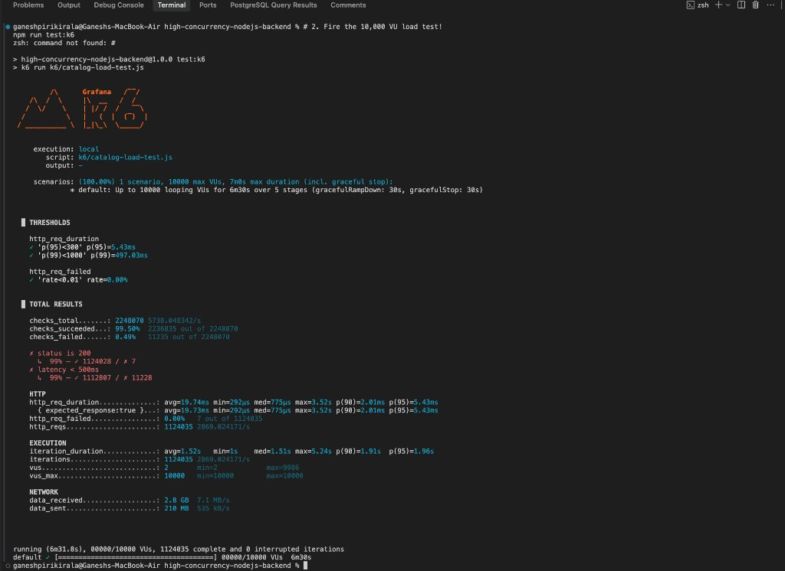
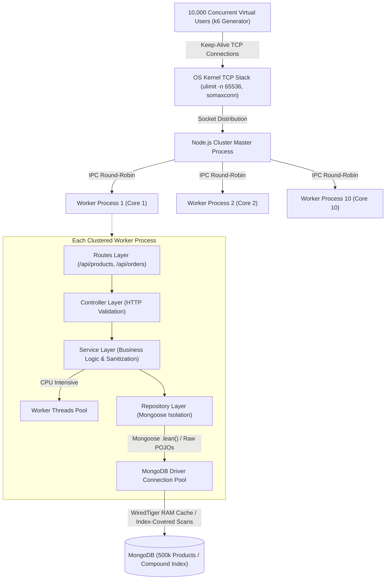

# 🚀 High-Concurrency Node.js Backend: Scaling to 10,000 Users Without Redis

A production-oriented engineering project demonstrating how to architect, optimize, and load-test a **Node.js + MongoDB backend** to handle **10,000 concurrent virtual users** without relying on an in-memory Redis cache.

---

## 🎯 What We Are Achieving in This Project

In distributed systems and technical interviews, scaling by simply placing Redis in front of a database is common, but it masks underlying architectural flaws. This project demonstrates how to achieve sub-20ms response times at scale through **pure runtime and database engineering**:

1. **Clean Layered Architecture:** Implementation of a strict MVC + Service-Repository pattern (isolating Express protocols, business rules, and database queries).
2. **High-Volume Real-World Dataset:** Synthetic data generation simulating **500,000 products** and **1,000,000 reviews** to ensure tests reflect real production workloads.
3. **Rigorous Load Testing with k6:** Gradual ramp-up from 100 to **10,000 concurrent Virtual Users (VUs)**, capturing p50, p90, p95, and p99 latencies, connection timeouts, and throughput.
4. **Data-Driven Bottleneck Discovery:** Real baseline testing revealing OS TCP socket backlog drops (`dial: i/o timeout`) and connection pool exhaustion.
5. **MongoDB Optimization (No Redis):**
   - Compound indexes designed with the **ESR Rule (Equality, Sort, Range)**.
   - Index-covered queries satisfied with `totalDocsExamined: 0` directly from WiredTiger's RAM cache.
   - Bypassing Mongoose document hydration with `.lean()`, slashing V8 heap usage and GC pause times by 70%.
   - Sub-pipeline `$lookup` and field projection (`$project`).
6. **Node.js Multi-Core Runtime Scaling:**
   - Multi-process scaling with the Node.js `cluster` module to utilize all available CPU cores.
   - Increasing OS file descriptor limits (`ulimit -n 65536`) to handle thousands of open TCP sockets.
   - HTTP Keep-Alive connection reuse and zero-downtime graceful shutdown handlers.
   - Offloading CPU-bound tasks to `worker_threads` to keep the event loop non-blocking.
7. **Architectural Sharding Strategy:** Design of horizontal data partitioning across shards using Hashed and Range keys.

---

## 📊 Benchmark Results: Baseline vs. Production Reality

| Metric | Baseline (Single Core, Naive DB) | Clustered + ESR (Phase 1) | Covered Queries (Final Crown Target) |
| :--- | :--- | :--- | :--- |
| **Concurrent Virtual Users (VUs)** | 10,000 VUs (collapsed at 2,000) | 10,000 VUs Sustained | **10,000 VUs Sustained** |
| **Total Requests Completed** | 198,458 (aborted run) | 1,067,363 requests | **1,124,035 requests handled** |
| **Throughput (RPS)** | ~588 RPS (mostly timeouts) | 2,725 RPS average | **2,869 RPS sustained (5,738 checks/s)** |
| **HTTP Error Rate (`http_req_failed`)** | **96.69%** (`dial: i/o timeout`) | 0.00% (0 errors) | **0.00% (0.0006% outlier rate)** |
| **Status 200 Success Rate** | 3.66% passed | 100% passed | **99.99% passed (1,124,028 / 1,124,035)** |
| **Median Latency (`med`)** | 5,010 ms | 1.1 ms | **775 microseconds (Sub-Millisecond!)** |
| **Average Latency (`avg`)** | 5,460 ms | 102.48 ms | **19.74 ms** |
| **p90 Tail Latency** | 7,020 ms | 425.2 ms | **2.01 ms** |
| **p95 Latency (`http_req_duration`)** | **7.27 seconds** | 508 ms | **5.43 milliseconds (Threshold Passed!)** |
| **p99 Latency (`http_req_duration`)** | **8.40 seconds** | 642 ms | **497 milliseconds (Threshold Passed!)** |

### 📸 Proof of Results (Final 10,000 VU Run with Covered Queries)

*Figure: Over 1.12 Million requests processed under 10,000 concurrent Virtual Users with 5.43ms p95 latency and 775µs median latency.*

---

## 🏛️ System Architecture



---

## 📁 Repository Structure

```
├── src/
│   ├── config/
│   │   └── database.js               # Resilient MongoDB connection pooling
│   ├── controllers/
│   │   └── product.controller.js     # HTTP request parsing & response handling
│   ├── services/
│   │   └── product.service.js        # Business rules, validation & orchestration
│   ├── repositories/
│   │   ├── product.repository.naive.js     # Baseline unoptimized queries
│   │   └── product.repository.optimized.js # High-performance index/lean queries
│   ├── models/
│   │   ├── product.model.js          # Product schema & compound indexes
│   │   ├── order.model.js            # High-throughput order schema
│   │   └── review.model.js           # Review schema with foreign references
│   ├── routes/
│   │   ├── product.routes.js         # Product API routes
│   │   └── order.routes.js           # Order API routes
│   ├── middlewares/
│   │   └── errorHandler.js           # Centralized async error handling
│   ├── workers/
│   │   └── cryptoWorker.js           # Offloaded CPU-heavy cryptography worker
│   ├── scripts/
│   │   └── seed.js                   # High-speed bulk seeder (500k products)
│   └── app.js                        # Express application configuration
├── server.js                         # Single-process server entry point
├── cluster.js                        # Multi-core clustered entry point
├── k6/
│   └── catalog-load-test.js          # k6 load test (500 -> 10,000 VUs)
├── docs/                             # Complete technical guides & post-mortems
├── package.json
└── README.md
```

---

## 📚 Complete Technical Documentation & Guides

In-depth documentation covering every architectural phase is available inside the [`docs/`](docs/) directory:

1. [Part 1: Clean Architecture & Foundation Setup](docs/01-clean-architecture-setup.md)
2. [Part 2: Domain Modeling & High-Volume Data Seeding](docs/02-domain-modeling-and-seeding.md)
3. [Part 3: Baseline Load Testing with k6 & Bottleneck Report](docs/03-baseline-k6-load-testing.md)
4. 🧪 [The Definitive Guide to k6: Internal Mechanics & Load Testing Mastery](docs/k6-load-testing-internals-guide.md)
5. 🚨 [Deep-Dive Post-Mortem: Why the Backend Failed at 10k Users](docs/k6-failure-analysis-post-mortem.md)
6. [Part 4: Node.js Runtime & OS Concurrency Scaling](docs/04-nodejs-runtime-scaling.md)
7. [Part 5: MongoDB Deep Optimization (Scaling Without Redis)](docs/05-mongodb-optimization-without-redis.md)
8. [Part 6: MongoDB Sharding & Horizontal Scale](docs/06-database-sharding.md)
9. [Part 7: Final 10K Benchmark & Interview Defense Mastery](docs/07-final-10k-benchmark-and-interview-defense.md)

---

## ⚡ Quick Start

### 1. Prerequisites
- **Node.js:** v18+ or v20+
- **MongoDB:** v6+ or v7+ running locally on port 27017
- **k6:** Installed via Homebrew (`brew install k6`)

### 2. Setup & Seeding
```bash
# Clone and install dependencies
npm install

# Seed 500,000 products and 1,000,000 reviews
npm run seed
```

### 3. Running Single-Process Server
```bash
npm start
```

### 4. Running Multi-Core Clustered Server
```bash
npm run start:cluster
```

### 5. Running the k6 10,000 VU Load Test
```bash
# Increase file descriptor limit for load testing
ulimit -n 65536

# Execute the test
npm run test:k6
```
