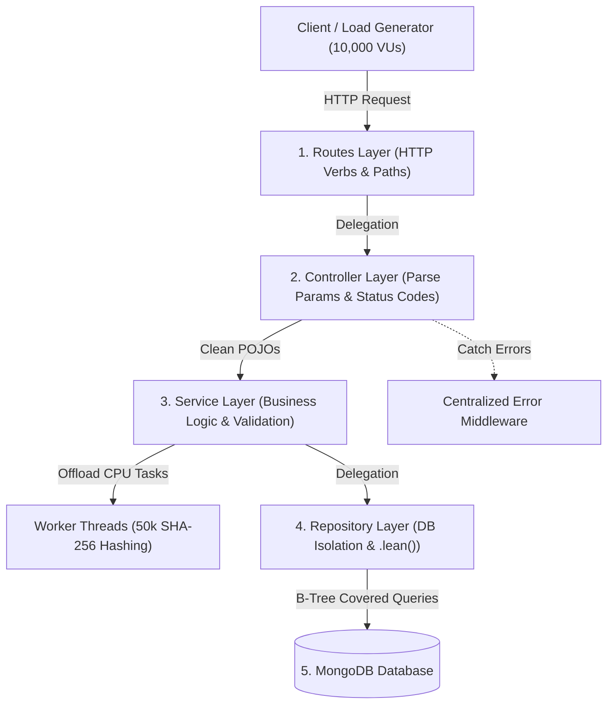

# Part 1: Clean Architecture & Foundation Setup

This guide establishes the production-grade Layered Architecture (MVC + Service-Repository pattern) for scaling a Node.js backend. Every component is isolated into distinct operational layers to guarantee testability, maintainability, and horizontal scalability under high concurrency.

---

## 1. Complete Directory Structure

```
├── src/
│   ├── config/
│   │   └── database.js               # Resilient MongoDB connection pooling
│   ├── controllers/
│   │   ├── product.controller.js     # Product HTTP input parsing & response formatting
│   │   └── order.controller.js       # Order HTTP handling
│   ├── services/
│   │   ├── product.service.js        # Product business sanitization & pagination bounds
│   │   └── order.service.js          # Order business validation & worker thread hashing
│   ├── repositories/
│   │   ├── product.repository.naive.js     # Unoptimized baseline queries (COLLSCAN)
│   │   ├── product.repository.optimized.js # Covered index scans (.lean() + sub-pipelines)
│   │   └── order.repository.js       # Order persistence with write concerns
│   ├── models/
│   │   ├── product.model.js          # Product schema & covered compound indexes
│   │   ├── order.model.js            # Order schema & user order history indexes
│   │   └── review.model.js           # Review schema & foreign lookup indexes
│   ├── routes/
│   │   ├── product.routes.js         # Product route mounting
│   │   └── order.routes.js           # Order route mounting
│   ├── middlewares/
│   │   └── errorHandler.js           # Centralized Express error handler
│   ├── util/
│   │   └── cryptoPool.js             # Worker thread pool dispatcher
│   ├── workers/
│   │   └── cryptoWorker.js           # CPU hashing worker (50k SHA-256 iterations)
│   └── app.js                        # Express app configuration
├── server.js                         # Single-process server entry point
├── cluster.js                        # Multi-core clustered entry point
├── k6/
│   └── catalog-load-test.js          # 10k VU stress testing script
├── package.json
└── README.md
```

---

## 2. Architectural Responsibilities (The Layered Pattern)

$$\text{HTTP Request} \longrightarrow \text{Routes} \longrightarrow \text{Controllers} \longrightarrow \text{Services} \longrightarrow \text{Repositories} \longrightarrow \text{MongoDB}$$



1. **Routes (`src/routes/`):** Map HTTP verbs (`GET`, `POST`) and URLs to controller handlers. No business or database logic lives here.
2. **Controllers (`src/controllers/`):** Extract parameters (`req.query`, `req.params`, `req.body`), validate basic HTTP presence, call services, and return standardized status envelopes (`200 OK`, `201 Created`).
3. **Services (`src/services/`):** Own business rules, fail-fast input validation (e.g. `ObjectId.isValid()`), parameter sanitization (clamping bounds), and orchestration (e.g., dispatching heavy crypto tasks to worker threads).
4. **Repositories (`src/repositories/`):** Directly interact with Mongoose models. All database optimizations (`.lean()`, `.select()`, covered queries, aggregations, and write concerns) are isolated here.
5. **Models (`src/models/`):** Define Mongoose schemas, data types, and compound indexes following the **ESR Rule**.

---

## 3. Implementation of Foundation Layers

### A. Resilient Database Connection Pool (`src/config/database.js`)
Configures the MongoDB driver connection pool with resilient pool bounds, idle socket cleanup, and lifecycle listeners:

```javascript
const mongoose = require('mongoose');

const connectDatabase = async () => {
  const mongoURI = process.env.MONGO_URI || 'mongodb://127.0.0.1:27017/scale_10k_db';

  const options = {
    // Keep between 10 and 50 open sockets in the pool per process
    minPoolSize: 10,
    maxPoolSize: 50,

    // Fail fast if a connection cannot be acquired from the pool within 5s
    waitQueueTimeoutMS: 5000,

    // Close idle sockets after 30 seconds
    maxIdleTimeMS: 30000,

    // Network timeouts
    serverSelectionTimeoutMS: 5000,
    socketTimeoutMS: 45000,
  };

  try {
    await mongoose.connect(mongoURI, options);
    console.log(`Database : connection successfully to ${mongoURI}`);
  } catch (error) {
    console.error(`Database : connection failed`, error.message);
    process.exit(1);
  }

  mongoose.connection.on('disconnected', () => {
    console.warn('Database : lost connection to mongoDB');
  });

  mongoose.connection.on('reconnected', () => {
    console.log('Database : reconnected to mongoDB');
  });
};

module.exports = { connectDatabase };
```

---

### B. Centralized Error Handler (`src/middlewares/errorHandler.js`)
Catches all unhandled exceptions and promise rejections across all controllers without crashing the process:

```javascript
const errorHandler = (err, req, res, next) => {
  const statusCode = err.statusCode || 500;
  const message = err.message || 'Internal server error';

  if (process.env.NODE_ENV !== 'production' && statusCode === 500) {
    console.error('[Unhandled Error]', err);
  }

  res.status(statusCode).json({
    success: false,
    error: {
      message,
      ...(process.env.NODE_ENV === 'development' && { stack: err.stack }),
    },
  });
};

module.exports = errorHandler;
```

---

### C. Express Application Configuration (`src/app.js`)

```javascript
const express = require('express');
const errorHandler = require('./middlewares/errorHandler');

const app = express();

// Disable x-powered-by header to reduce response byte overhead
app.disable('x-powered-by');

// Parse JSON payloads with sensible byte limits
app.use(express.json({ limit: '64kb' }));
app.use(express.urlencoded({ extended: true, limit: '64kb' }));

// Health check endpoint for load balancers
app.get('/health', (req, res) => {
  res.status(200).json({ status: 'healthy', timestamp: Date.now() });
});

// Import and mount route modules
const productRoutes = require('./routes/product.routes');
const orderRoutes = require('./routes/order.routes');

app.use('/api/products', productRoutes);
app.use('/api/orders', orderRoutes);

// Global Error Handler (must be mounted after all routes)
app.use(errorHandler);

module.exports = app;
```

---

### D. Server Entry Point with Socket Tuning (`server.js`)

```javascript
require('dotenv').config();
const app = require('./src/app');
const { connectDatabase } = require('./src/config/database');

const PORT = process.env.PORT || 3000;

async function startServer() {
  await connectDatabase();

  const server = app.listen(PORT, () => {
    console.log(`[Server] Running on http://localhost:${PORT} (PID : ${process.pid})`);
  });

  // High-concurrency socket tuning
  server.keepAliveTimeout = 65000; // Reuse TCP socket across consecutive HTTP requests
  server.headersTimeout = 66000;   // Must be greater than keepAliveTimeout

  // Graceful shutdown handler
  const gracefulShutdown = (signal) => {
    console.log(`\n[Server] Received ${signal}. Draining active connections...`);
    server.close(() => {
      console.log('[Server] All connections closed. Exiting.');
      process.exit(0);
    });

    // Force exit if connections refuse to drain within 10s
    setTimeout(() => {
      console.error('[Server] Forcing shutdown after timeout.');
      process.exit(1);
    }, 10000);
  };

  process.on('SIGTERM', () => gracefulShutdown('SIGTERM'));
  process.on('SIGINT', () => gracefulShutdown('SIGINT'));
}

startServer();
```
