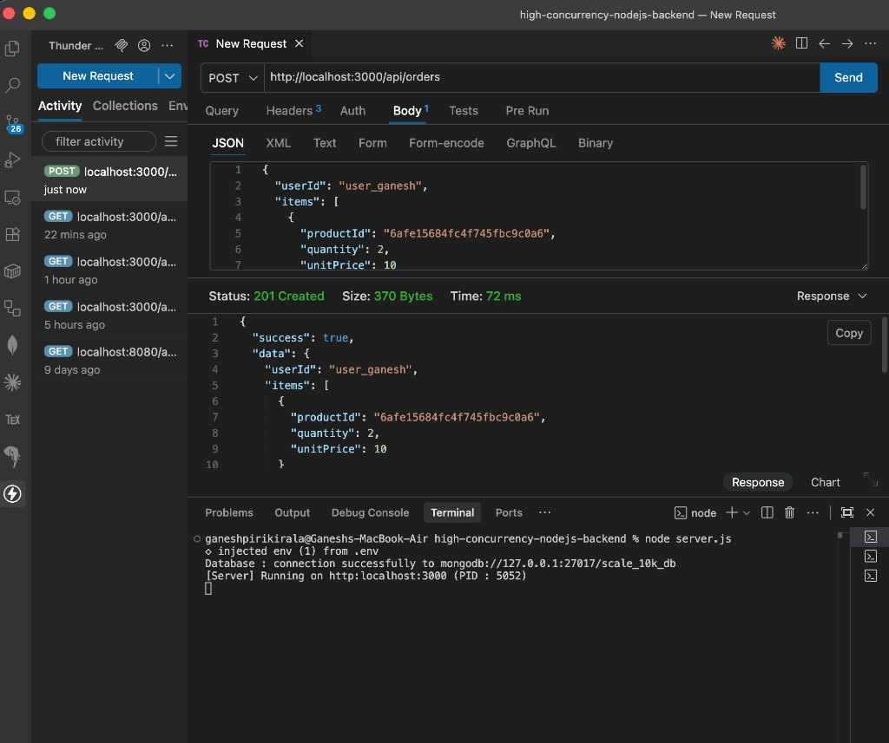

# Part 4: Node.js Runtime & OS Concurrency Scaling

Handling 10,000 concurrent Virtual Users requires moving beyond default single-threaded Node.js configurations and tuning both the runtime and the underlying operating system. This guide covers the OS kernel adjustments, multi-process clustering with round-robin socket balancing, offloading CPU-bound tasks to `worker_threads`, and implementing a resilient, non-blocking order write pipeline.

---

## 1. Operating System Tuning (File Descriptors)

In Unix-based operating systems (macOS, Linux), **every open TCP socket is represented as a file descriptor**.

### The Default Bottleneck:
By default, macOS sets each process file descriptor limit to **256 or 1,024**.
If 10,000 concurrent users attempt to connect simultaneously:
1. The process exhausts its file descriptor limit after ~1,000 open sockets.
2. The operating system kernel immediately rejects subsequent TCP `SYN` packets.
3. Clients receive `dial: i/o timeout` or `socket: too many open files`.

### Inspecting and Raising Limits:
Check current session limit:
```bash
ulimit -n
```

Raise the open file descriptor limit for high-concurrency testing:
```bash
ulimit -n 65536
```

---

## 2. Multi-Core Scaling with Node.js Cluster (`cluster.js`)

Node.js runs single-threaded by default. On a 10-core CPU (such as an Apple M-series or modern server), a single-process server leaves **90% of the machine's hardware compute capacity idle**.

### Architecture: Master & Worker Topology

```
                  ┌─────────────────────────────────────────┐
                  │      Operating System TCP Stack         │
                  │   (Port 3000, ulimit -n 65536)          │
                  └────────────────────┬────────────────────┘
                                       │
                                       ▼
                  ┌─────────────────────────────────────────┐
                  │       Master Process (PID 97079)        │
                  │   * Inspects os.cpus().length (10 Cores)│
                  │   * IPC Round-Robin Socket Distributor  │
                  └──────┬─────────────┬─────────────┬──────┘
                         │             │             │
          ┌──────────────┴──┐   ┌──────┴────────┐   ┌┴────────────────┐
          ▼                 ▼   ▼               ▼   ▼                 ▼
   ┌─────────────┐   ┌─────────────┐     ┌─────────────┐       ┌─────────────┐
   │ Worker 1    │   │ Worker 2    │ ... │ Worker 9    │       │ Worker 10   │
   │ (PID 97080) │   │ (PID 97081) │     │ (PID 97088) │       │ (PID 97089) │
   │ 50 DB Sockets   │ 50 DB Sockets     │ 50 DB Sockets       │ 50 DB Sockets
   └─────────────┘   └─────────────┘     └─────────────┘       └─────────────┘
```

### Complete Implementation ([cluster.js](file:///Users/ganeshpirikirala/Desktop/high-concurrency-nodejs-backend/cluster.js)):

```javascript
const cluster = require('cluster');
const os = require('os');
const { connectDatabase } = require('./src/config/database');
const app = require('./src/app');

const numCPUs = os.cpus().length;

if (cluster.isPrimary) {
  console.log(`[Master ${process.pid}] Spawning ${numCPUs} worker processes...`);

  // 1. Fork a worker process for every physical/logical CPU core
  for (let i = 0; i < numCPUs; i++) {
    cluster.fork();
  }

  // 2. Auto-heal: Respawn worker if one crashes unexpectedly
  cluster.on('exit', (worker, code, signal) => {
    console.warn(`[Master] Worker ${worker.process.pid} died (${signal || code}). Respawning...`);
    cluster.fork();
  });
} else {
  // 3. Worker Process Execution
  const PORT = process.env.PORT || 3000;

  connectDatabase().then(() => {
    const server = app.listen(PORT, () => {
      console.log(`Worker ${process.pid} Listening on port ${PORT}`);
    });

    // 4. HTTP Keep-Alive Tuning
    server.keepAliveTimeout = 65000; // Keep TCP socket open longer than upstream clients
    server.headersTimeout = 66000;   // Must strictly exceed keepAliveTimeout
    server.maxHeadersCount = 100;

    // 5. Zero-Downtime Graceful Shutdown Handler
    const gracefulShutdown = (signal) => {
      console.log(`[Worker ${process.pid}] Received ${signal}. Draining active connections...`);
      server.close(() => {
        console.log(`[Worker ${process.pid}] Closed active connections. Exiting.`);
        process.exit(0);
      });

      // Force terminate after 10s if connections fail to drain
      setTimeout(() => {
        console.error(`[Worker ${process.pid}] Forcing shutdown after timeout.`);
        process.exit(1);
      }, 10000);
    };

    process.on('SIGTERM', () => gracefulShutdown('SIGTERM'));
    process.on('SIGINT', () => gracefulShutdown('SIGINT'));
  });
}
```

---

### 🧠 Critical Clustered Concurrency Concepts:

#### 1. How Workers Share Port 3000 (`SO_REUSEPORT` / Round-Robin):
On Unix systems, the master process opens the listen socket on port 3000 and hands file descriptors to worker processes via Inter-Process Communication (IPC). The OS kernel and Node cluster distribute incoming TCP connection requests across the workers using round-robin load balancing.

#### 2. Clustered Database Connection Pool Calculation:
Each worker process runs its own isolated V8 engine and its own MongoDB driver instance.
$$\text{Total DB Connections} = \text{Worker Processes} \times \text{maxPoolSize}$$
With 10 workers and `maxPoolSize: 50`:
$$\text{Total Potential Sockets} = 10 \times 50 = 500\text{ connections}$$
Make sure your MongoDB server configuration (`maxConns`) can accommodate this multiplier. Setting `waitQueueTimeoutMS: 5000` prevents queries from piling up in an infinite wait queue if the database gets busy.

#### 3. Socket Keep-Alive Tuning:
- Default Node.js `keepAliveTimeout` is only 5 seconds. Under high traffic, client connections are aggressively closed, forcing expensive 3-way TCP handshakes on every request.
- Setting `keepAliveTimeout = 65000` and `headersTimeout = 66000` enables clients (and k6 VUs) to reuse persistent TCP connections across thousands of HTTP iterations.

---

## 3. Offloading CPU Tasks with Worker Threads

### 🧠 The Single-Threaded Event Loop Hazard
Node.js processes I/O asynchronously, but **JavaScript execution itself is single-threaded**.
If an endpoint executes synchronous CPU-bound code—such as calculating a cryptographic signature, compressing a file, or running 50,000 SHA-256 hash iterations:
- The event loop thread is 100% frozen for 20ms to 50ms.
- While the CPU calculates the hash, **no incoming HTTP requests can be accepted**, and **no database query callbacks can run**.
- Under 10,000 concurrent users, just a few synchronous CPU calculations cause massive request queues, resulting in cascading timeouts (`dial: i/o timeout`).

---

### 🛠️ The Architecture: Worker Threads Pool

To solve this, we offload CPU computation to **`worker_threads`**. Unlike `cluster.fork()` (which creates heavy OS processes), worker threads share memory within the process and run on isolated background threads.

#### 1. The Worker Thread Script ([src/workers/cryptoWorker.js](file:///Users/ganeshpirikirala/Desktop/high-concurrency-nodejs-backend/src/workers/cryptoWorker.js)):
```javascript
const { parentPort, workerData } = require('worker_threads');
const crypto = require('crypto');

function computeOrderSignature(payload) {
  // Heavy computation: 50,000 sequential SHA-256 hash iterations
  let hash = payload;
  for (let i = 0; i < 50000; i++) {
    hash = crypto.createHash('sha256').update(hash).digest('hex');
  }
  return hash;
}

// Receive payload from main thread, calculate signature, and post result back
const signature = computeOrderSignature(workerData);
parentPort.postMessage({ signature });
```

#### 2. The Thread Pool Dispatcher ([src/util/cryptoPool.js](file:///Users/ganeshpirikirala/Desktop/high-concurrency-nodejs-backend/src/util/cryptoPool.js)):
```javascript
const { Worker } = require('worker_threads');
const path = require('path');

function runCryptoTask(payload) {
  return new Promise((resolve, reject) => {
    const worker = new Worker(path.join(__dirname, '../workers/cryptoWorker.js'), {
      workerData: payload,
    });

    worker.on('message', (res) => resolve(res.signature));
    worker.on('error', reject);
    worker.on('exit', (code) => {
      if (code !== 0) reject(new Error(`Worker stopped with exit code ${code}`));
    });
  });
}

module.exports = { runCryptoTask };
```

---

## 4. The High-Throughput Write Path (`POST /api/orders`)

We combined our worker thread pool and database write concerns into a complete, non-blocking order placement pipeline.

### Pipeline Flow:
```
[Client POST /api/orders]
           │
           ▼
[Order Controller] ──► Validates HTTP body (userId, items, totalAmount)
           │
           ▼
[Order Service]    ──► Validates structure & item prices
           │
           ├──► [runCryptoTask (Worker Thread)] ──► 50,000 SHA-256 hashes (Main loop 100% free!)
           │           │
           │           ▼
           └──◄ Returns paymentSignature
           │
           ▼
[Order Repository] ──► Persists with Write Concern { w: 1, wtimeoutMS: 5000 }
           │
           ▼
[201 Created Response]
```

### 📸 Operational Verification (Thunder Client):
Order created in **72 milliseconds** with payment signature computed in a background worker thread:


### ⚠️ Common Development Gotcha: Node.js In-Memory Caching
When editing routes or controllers in a plain Node.js server, **Node does NOT hot-reload files**.
If you add `POST /api/orders` while the server process is running, Express returns:
```html
<pre>Cannot POST /api/orders</pre>
```
Always terminate the old process (`Ctrl + C`) and restart `node server.js` to ensure the newly registered route handlers are loaded into V8 memory.
