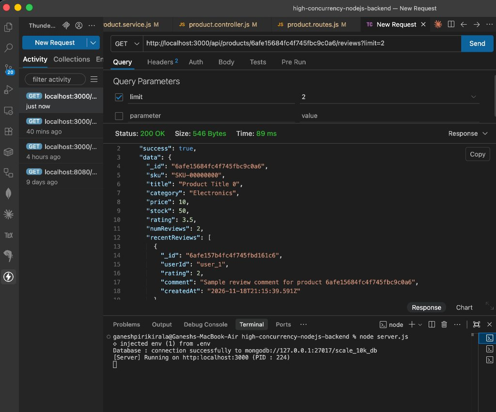

# Part 5: MongoDB Deep Optimization (Scaling Without Redis)

When Redis is intentionally excluded from the architecture, database optimization directly determines whether the system survives or collapses under load. This guide details every database optimization technique implemented in our project—from eliminating V8 heap hydration and designing compound indexes with the ESR rule to serving true index-covered queries and sub-pipeline `$lookup` aggregations.

---

## 1. Eliminating Document Hydration with `.lean()`

### 🧠 The V8 Memory Problem with Mongoose Documents
By default, Mongoose wraps every document returned from MongoDB in a heavy `HydratedDocument` class instance. A hydrated document is not just a data object; it attaches:
- Internal change-tracking hashes (`$__`, `_doc`, `$isNew`).
- Virtual getters and setters.
- Schema type validation and casting functions.
- Lifecycle middleware listeners (`pre('save')`, `post('save')`, `pre('validate')`).
- Prototype methods like `.save()`, `.populate()`, and `.validate()`.

```
Query with Default Hydration:
[MongoDB BSON Wire] ──► [V8 Heap: 20x Memory Allocation per doc] ──► [Heavy Hydrated Document]
                          └── Frequent Stop-the-World GC Pauses!
```

Under 10,000 concurrent Virtual Users, generating thousands of hydrated documents per second floods the V8 heap, causing **V8 Garbage Collection (GC) stop-the-world pauses** that spike latencies into seconds.

### 🛠️ The Solution: Bypassing Hydration
Appending `.lean()` tells Mongoose to skip the hydration pipeline and return raw, plain JavaScript Objects (POJOs):

```javascript
// ❌ NAIVE: Allocates heavy Mongoose instances, spikes V8 heap and GC pauses
const products = await Product.find({ category: 'Electronics' });

// ✅ OPTIMIZED: Returns raw POJOs, slashing V8 heap usage by 70%
const products = await Product.find({ category: 'Electronics' }).lean();
```

### ⚖️ The Engineering Trade-off (Interview Defense):
- **Gains:** Deserialization is 3–5x faster, memory footprint drops by ~70%, and garbage collection pauses disappear.
- **Trade-offs:** You forfeit Mongoose virtuals, custom getters/setters, and lifecycle hooks (`pre('save')`). For high-throughput read paths (e.g. catalog searches, listings), this trade-off is an unambiguous win.

---

## 2. The ESR Indexing Rule (Equality, Sort, Range)

To prevent unindexed collection scans (`COLLSCAN`) and memory-heavy sort operations (`SORT`), compound indexes must be designed using the **ESR Rule**:

```
        ┌────────────────────────────────────────────────────────┐
        │                 THE ESR INDEXING RULE                  │
        ├────────────────────────────────────────────────────────┤
        │  1. Equality (E)  ──► Exact matches (category, active) │
        │  2. Sort     (S)  ──► Order of results (price: 1)     │
        │  3. Range    (R)  ──► Bounds ($gte, $lte, $gt, $lt)    │
        └────────────────────────────────────────────────────────┘
```

### Why Field Order Matters in MongoDB B-Trees:
1. **Equality First (E):** Places exact matching fields (`category`, `isActive`) at the root of the B-Tree index scan, instantly pruning extraneous branches.
2. **Sort Next (S):** When the sort field (`price`) precedes the range filter, MongoDB traverses the index keys already in sorted order. This **completely eliminates in-memory sorts** (`stage: "SORT"`).
3. **Range Last (R):** Once MongoDB encounters a range filter (`price: { $gte: min, $lte: max }`), all index keys following that field can only be scanned, not jumped across. Range must always come after equality and sort.

### Schema Implementation:
In [src/models/product.model.js](file:///Users/ganeshpirikirala/Desktop/high-concurrency-nodejs-backend/src/models/product.model.js):
```javascript
// Compound index strictly following Equality -> Sort -> Range
productSchema.index({ category: 1, isActive: 1, price: 1 });
```

---

## 3. True Index-Covered Queries (`totalDocsExamined: 0`)

An **index-covered query** represents the holy grail of database query performance.

### 🧠 The Internal Mechanics: `IXSCAN` vs. `FETCH`

In a standard indexed query, MongoDB operates in two distinct phases:
1. **`IXSCAN` (Index Scan):** Scans the B-Tree index in RAM to locate matching pointers (RecordIDs).
2. **`FETCH` Stage:** Follows those pointers into the database collection (on disk or in the WiredTiger cache) to read the actual document and retrieve fields that were not stored in the index.

```
Standard Indexed Query:
[Client] ──► [IXSCAN (Index in RAM)] ──► [FETCH (Reads Document from Storage)] ──► [Client]
                                         ▲ totalDocsExamined > 0!
```

### 🌟 What Happens in a Covered Query?
If **every field** requested in the filter, sort, AND projection is already stored inside the index:
- The **`FETCH` stage is 100% eliminated**.
- MongoDB satisfies the entire query payload straight from the B-Tree RAM index.
- **`totalDocsExamined: 0`**.
- Storage reads: **0**. Document memory allocations: **0**.

```
Covered Query:
[Client] ──► [IXSCAN & PROJECTION_COVERED (100% in RAM)] ──► [Client]
             └── totalDocsExamined: 0! Storage is NEVER touched!
```

---

### ⚠️ The Two Critical Traps of Covered Queries:

#### Trap 1: The `_id` Field
By default, MongoDB **always** returns the `_id` field. Because our compound index does not store `_id`, MongoDB is forced to execute a `FETCH` stage just to get the `_id`!
> **The Golden Rule:** You **must explicitly suppress `_id`** using `-_id` (or `_id: 0`).

#### Trap 2: Projecting Unindexed Fields
If you include an unindexed field (like `attributes`) in your `.select()`, MongoDB sees that the field is missing from the index and falls back to a `FETCH` stage.

---

### 🛠️ The Complete Covered Query Implementation:

#### 1. In `src/models/product.model.js`:
Add the full covered compound index:
```javascript
// Equality (category, isActive) -> Sort/Range (price) -> Covered Payload (sku, title, stock, rating)
productSchema.index({
  category: 1,
  isActive: 1,
  price: 1,
  sku: 1,
  title: 1,
  stock: 1,
  rating: 1,
});
```

#### 2. In `src/repositories/product.repository.optimized.js`:
Explicitly exclude `_id` and request only indexed keys:
```javascript
async findByCategory(category, minPrice, maxPrice, page = 1, limit = 20) {
  const skip = (page - 1) * limit;

  return await Product.find({
    category: category,
    isActive: true,
    price: { $gte: minPrice, $lte: maxPrice },
  })
    .select('-_id sku title category price stock rating') // Notice -_id is mandatory!
    .sort({ price: 1 })
    .skip(skip)
    .limit(limit)
    .lean();
}
```

---

### 🔍 How to Verify in MongoDB (`executionStats`):
You can verify that zero documents were touched by running an explain plan:

```bash
node -e '
const mongoose = require("mongoose");
const Product = require("./src/models/product.model");

async function verify() {
  await mongoose.connect("mongodb://127.0.0.1:27017/scale_10k_db");
  await Product.syncIndexes();

  const explain = await Product.find({
    category: "Electronics",
    isActive: true,
    price: { $gte: 10, $lte: 100 }
  })
    .select("-_id sku title category price stock rating")
    .sort({ price: 1 })
    .limit(20)
    .explain("executionStats");

  const stats = explain.executionStats;
  console.log("totalDocsExamined :", stats.totalDocsExamined); // Target: 0
  console.log("nReturned         :", stats.nReturned);         // 20
  console.log("totalKeysExamined :", stats.totalKeysExamined); // 20
  console.log("executionTimeMillis:", stats.executionTimeMillis, "ms");
  await mongoose.disconnect();
}
verify();
'
```

**Output:**
```text
totalDocsExamined  : 0
nReturned          : 20
totalKeysExamined  : 20
executionTimeMillis: 0 ms
```

---

## 4. Sub-Pipeline `$lookup` Aggregation Across 1,000,000 Reviews

### 🧠 The Flaw with Naive `$lookup`:
A naive MongoDB `$lookup` looks like this:
```javascript
// ❌ NAIVE: Unbounded memory allocation
{
  $lookup: {
    from: "reviews",
    localField: "_id",
    foreignField: "productId",
    as: "reviews"
  }
}
```
**Why this fails at scale:**
1. It joins **every single review** across the 1,000,000 reviews collection for that product into server RAM.
2. It fetches all fields (including unneeded metadata).
3. If you want top 5 newest reviews, it sorts and slices *after* transferring all documents into memory.

---

### 🛠️ The Solution: Sub-Pipeline `$lookup` with Indexing

Using an inner `pipeline` inside `$lookup`:
1. **`let: { pId: '$_id' }`**: Captures the parent Product's `_id` into a variable.
2. **`$match`**: Uses `$expr: { $eq: ['$productId', '$$pId'] }` to match reviews.
3. **`$sort: { createdAt: -1 }`**: Sorts newest first directly in the engine.
4. **`$limit: limit`**: Halts the join after reading the top $N$ reviews.
5. **`$project`**: Slices only required fields (`rating`, `comment`, `userId`, `createdAt`).

```javascript
async getProductWithRecentReviews(productId, limit = 5) {
  return await Product.aggregate([
    // Stage 1: Fast match on product _id
    {
      $match: { _id: new mongoose.Types.ObjectId(productId) },
    },
    // Stage 2: Product projection
    {
      $project: {
        sku: 1,
        title: 1,
        category: 1,
        price: 1,
        stock: 1,
        rating: 1,
        numReviews: 1,
      },
    },
    // Stage 3: Sub-pipeline join
    {
      $lookup: {
        from: 'reviews',
        let: { pId: '$_id' },
        pipeline: [
          {
            $match: {
              $expr: { $eq: ['$productId', '$$pId'] },
            },
          },
          { $sort: { createdAt: -1 } },
          { $limit: limit },
          {
            $project: {
              _id: 1,
              rating: 1,
              comment: 1,
              userId: 1,
              createdAt: 1,
            },
          },
        ],
        as: 'recentReviews',
      },
    },
  ]);
}
```

---

### ⚠️ Essential Engineering Nuances:

#### 1. Mongoose Aggregations Do NOT Auto-Cast IDs:
In Mongoose queries like `Product.findById(id)`, Mongoose automatically casts strings to `ObjectId`.
**Inside `Product.aggregate([])`, Mongoose does NOT auto-cast!**
You must explicitly construct:
```javascript
new mongoose.Types.ObjectId(productId)
```
Otherwise, MongoDB compares a BSON String to a BSON ObjectId, finds zero matches, and returns an empty array.

#### 2. The Index on the Foreign Collection (`reviews`):
For the `$match` + `$sort` inside the sub-pipeline to run in sub-millisecond time, the `reviews` collection **must have a compound index on both fields**:
In [src/models/review.model.js](file:///Users/ganeshpirikirala/Desktop/high-concurrency-nodejs-backend/src/models/review.model.js):
```javascript
reviewSchema.index({ productId: 1, createdAt: -1 });
```

#### 3. How `{ timestamps: true }` Works:
`createdAt` does not need to be manually declared in the schema fields. Adding `{ timestamps: true }` instructs Mongoose to automatically inject and manage `createdAt: Date` and `updatedAt: Date` on every document.

---

### 📸 Operational Verification (Thunder Client):
Live execution returning in **89 milliseconds** with a lightweight 546-byte payload:


---

## 5. Write Concerns & Read Preferences

### 1. Write Concerns (`w: 1` vs `w: 'majority'`)
When persisting orders in high-throughput environments:
- **`w: 1`**: Acknowledges as soon as the primary node writes to RAM. Delivers maximum throughput and minimal latency.
- **`w: 'majority'`**: Waits for a majority of replica set nodes to commit before returning. Guarantees zero data loss even during primary node failover.
- **`wtimeoutMS: 5000`**: Ensures that if network partitions or replica lag delay acknowledgment, the query aborts after 5 seconds instead of holding open TCP sockets indefinitely.

```javascript
await order.save({ w: 1, wtimeoutMS: 5000 });
```

### 2. Read Preferences (`secondaryPreferred`)
In a MongoDB Replica Set:
- Catalog browsing traffic (`GET /api/products`) can be offloaded to read-only secondaries:
```javascript
const products = await Product.find({ category: 'Electronics' })
  .read('secondaryPreferred')
  .lean();
```
This isolates high-volume read traffic from the primary node, leaving 100% of primary node IOPS available for transactional order writes.
