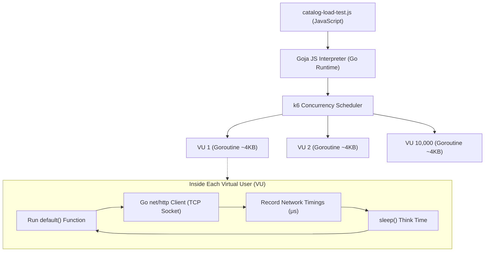

# 🚀 The Definitive Guide to k6: Internal Mechanics & Load Testing Mastery

This guide explains how **k6** works under the hood, how it executes load tests, how it simulates thousands of concurrent users on a single machine, and how to interpret every metric and error message.

---

## 1. What is k6 Under the Hood?

Many developers assume k6 runs on Node.js or opens thousands of invisible browser windows. **It does neither.**

* **Core Runtime:** k6 is written in **Go (Golang)**.
* **JavaScript Engine:** It embeds **Goja**, an ECMAScript 5.1+ interpreter written in pure Go. It reads your JavaScript test script (`catalog-load-test.js`) and converts it into Go bytecode.
* **The Goroutine Advantage (Why k6 scales so easily):**
  * An operating system thread (like in standard multithreading) consumes **~1MB to 2MB of RAM**. Spawning 10,000 OS threads would require **10–20 GB of memory** and cause severe CPU context-switching overhead.
  * A Go **goroutine** is a lightweight user-space thread managed by the Go runtime, requiring only **~2KB to 4KB of RAM**.
  * k6 can easily spin up **10,000 parallel goroutines** on a standard laptop, consuming only a few hundred megabytes of RAM.



---

## 2. What Exactly is a Virtual User (VU)?

A **Virtual User (VU)** is **an independent infinite loop** running inside a dedicated Go goroutine.

When you define your default function:
```javascript
export default function () {
  http.get('http://localhost:3000/api/products?category=Electronics');
  sleep(1);
}
```

k6 executes the equivalent of this Go loop for **each active VU**:

```go
// Conceptually running inside k6 core:
for testStageIsActive {
    executeDefaultFunction() // Issues the HTTP GET request
    waitForSleepDuration()   // Pauses for user "Think Time"
    // Loop repeats immediately
}
```

### Key Properties of a VU:
1. **Total State Isolation:** VU 1 and VU 2 do not share variables, cookie jars, or session state. Each VU acts as an independent human user on their own device.
2. **Socket Reuse (HTTP Keep-Alive):** By default, each VU maintains a pool of persistent TCP sockets via `Connection: keep-alive`. It reuses the same TCP socket across multiple iterations, saving the overhead of repeated 3-way handshakes.
3. **Think Time Simulation:** Real users do not click 1,000 times a second. They click, read the screen for 1–3 seconds, and click again. The `sleep(Math.random() * 1 + 1)` simulates realistic user behavior.

---

## 3. The 3 Phases of the k6 Execution Lifecycle

Every k6 script executes in three distinct phases:

```
[1. Init Phase] ────────► [2. VU Execution Phase] ────────► [3. Teardown / Summary]
(Evaluated ONCE)          (Evaluated in Parallel x10,000)   (Aggregates Stats & Exits)
```

### Phase 1: Init Phase (Runs Once)
* Evaluates top-level imports (`import http from 'k6/http'`).
* Parses configuration options (`stages`, `thresholds`, `vus`).
* Prepares memory structures before any traffic is generated.

### Phase 2: VU Execution Phase (`export default function()`)
* The main engine runs here.
* The k6 scheduler dynamically scales the number of active goroutines up or down to match the target stages defined in `options.stages`.
* Executes code inside `export default function()` continuously until the stage ends.

### Phase 3: Summary & Reporting Phase
* Gathers all raw metrics collected by all 10,000 goroutines.
* Calculates statistical percentiles (p50, p90, p95, p99).
* Evaluates threshold rules and prints the terminal report.

---

## 4. Anatomy of an HTTP Request: How k6 Measures Time

When a VU executes `http.get(url)`, k6 instruments every microsecond of the underlying TCP and HTTP exchange:

```
|-------------------------------- http_req_duration --------------------------------|
|-- looking_up --|-- dialing --|-- tls_handshaking --|-- sending --|-- waiting (TTFB) --|-- receiving --|
```

| Timing Metric | Description | What It Tells You About the System |
| :--- | :--- | :--- |
| **`looking_up`** | Time spent resolving DNS hostname to IP. | High values indicate DNS server latency. |
| **`dialing`** | Time spent establishing the **TCP 3-way handshake** (`SYN` $\rightarrow$ `SYN-ACK` $\rightarrow$ `ACK`). | ⚠️ **This is where our baseline test failed!** When the server's OS socket backlog filled up, `dialing` stalled for 30s until timing out with `dial: i/o timeout`. |
| **`tls_handshaking`** | Time negotiating SSL/TLS certificates and ciphers. | Only applies to HTTPS URLs. |
| **`sending`** | Time taken to push the HTTP request headers and payload over the network. | Usually $< 1\text{ms}$ unless uploading large files. |
| **`waiting` (TTFB)** | **Time To First Byte:** Time spent waiting for the server to process the request and return the first byte of response data. | ⚠️ **Direct measure of backend code + database latency.** If MongoDB is slow (e.g. unindexed `COLLSCAN`), TTFB explodes to several seconds! |
| **`receiving`** | Time spent downloading the HTTP response body. | High values indicate large JSON payloads or slow network bandwidth. |

> **The Core Formula:**
> $$\text{http\_req\_duration} = \text{sending} + \text{waiting (TTFB)} + \text{receiving}$$

---

## 5. Statistical Percentiles: Why "Averages" Lie in Performance Testing

k6 calculates metrics using High Dynamic Range (HDR) Histograms. In your baseline results, you saw:

```text
HTTP
http_req_duration: avg=5.46s  med=5.01s  p(90)=7.02s  p(95)=7.27s  p(99)=8.40s
```

### Why "Average" (Mean) is a Dangerous Metric:
Suppose you have 100 requests:
* 95 requests complete in **10 milliseconds**.
* 5 requests hang for **10,000 milliseconds (10 seconds)**.
* **The Math:**
  $$\text{Average Latency} = \frac{(95 \times 10) + (5 \times 10,000)}{100} = \frac{950 + 50,000}{100} = \mathbf{509.5\text{ ms}}$$
* If you tell an interviewer *"Our average latency was 500ms"*, you hide the fact that **5% of your customers suffered a 10-second freeze!**

### What Percentiles Actually Represent:
* **`med` (p50 / Median):** 50% of requests were faster than this value. It represents the experience of the typical user.
* **`p90`:** 90% of requests were faster than this value.
* **`p95`:** 95% of requests were faster than this value. Only 5% were slower.
* **`p99`:** The worst 1% of requests.
* **Industry Standard:** Production SLAs (Service Level Agreements) at companies like Google, Amazon, and Netflix are always evaluated at **p95 or p99**, never on averages.

---

## 6. Dissecting Common k6 Error Signatures

| Error in k6 Output | Architectural Root Cause | Where to Fix |
| :--- | :--- | :--- |
| **`dial: i/o timeout`** | k6 sent a TCP `SYN` packet to connect, but the server's OS listen backlog (`somaxconn`) was full and dropped it. After 30 seconds, k6 timed out. | Multi-process clustering (`cluster.js`) and increasing OS socket limits (`ulimit -n 65536`). |
| **`connection reset by peer` (`ECONNRESET`)** | The server abruptly severed an active TCP connection (e.g. Node process crashed with an Unhandled Exception or Out-Of-Memory). | Fix unhandled promise rejections and V8 heap exhaustion. |
| **`context deadline exceeded`** | The entire iteration exceeded k6's configured timeout deadline before completing. | Backend took too long to respond. |
| **HTTP 500 / 502 / 504** | Node.js returned a 500 status code, or an upstream reverse proxy (like Nginx) timed out waiting for Node to respond. | Optimize database queries and connection pool sizes. |

---

## 7. How k6 Schedules Workloads (Stages & Ramping)

In `k6/catalog-load-test.js`:

```javascript
export const options = {
  stages: [
    { duration: '30s', target: 500 },    // Stage 1: Linear ramp from 0 to 500 VUs
    { duration: '1m', target: 2000 },    // Stage 2: Linear ramp from 500 to 2,000 VUs
    { duration: '2m', target: 5000 },    // Stage 3: Stress ramp from 2,000 to 5,000 VUs
    { duration: '2m', target: 10000 },   // Stage 4: Spike to 10,000 VUs
    { duration: '1m', target: 0 },       // Stage 5: Graceful cool down to 0 VUs
  ],
};
```

* **Linear Interpolation:** k6 smoothly increases or decreases active goroutines every second to create a steady ramp line rather than an abrupt cliff.
* **Throughput Relationship:**
  $$\text{Requests Per Second (RPS)} \approx \frac{\text{Active VUs}}{\text{Iteration Duration (Response Time + Sleep)}}$$
  * When your backend responds in **2ms** with a **1s** sleep, 10,000 VUs generate:
    $$\frac{10,000}{0.002 + 1} \approx \mathbf{9,980 \text{ RPS}}$$
  * When your backend slows down to **7s** with a **1s** sleep, 10,000 VUs generate:
    $$\frac{10,000}{7.0 + 1} \approx \mathbf{1,250 \text{ RPS}}$$
  * *Crucial Interview Insight:* When a backend slows down, total RPS actually **drops** because VUs spend all their time waiting in TTFB queues rather than completing iterations!

---

## 8. Senior Interview Q&A Cheatsheet on k6

### Q1: "How can a single testing machine generate 10,000 virtual users without running out of memory?"
> **Answer:**
> "k6 is written in Go and utilizes goroutines rather than operating system threads. An OS thread consumes 1–2MB of stack space, which would require 10–20GB of memory for 10k threads. A Go goroutine consumes only 2–4KB, allowing k6 to multiplex 10,000 concurrent virtual users inside a few hundred megabytes of RAM on a single machine."

### Q2: "What is the difference between k6's `dialing` time and `waiting` (TTFB) time?"
> **Answer:**
> "`dialing` measures the time to complete the OS-level TCP 3-way handshake. High dialing time indicates network saturation or that the server's OS socket listen backlog is overflowing. 
> `waiting` (TTFB) measures the time from when the request was fully transmitted until the server sends back the first response byte. High TTFB indicates application-level or database-level bottlenecks, such as unindexed queries or connection pool exhaustion."

### Q3: "Why did our test report `dial: i/o timeout` instead of HTTP 500 errors?"
> **Answer:**
> "An HTTP 500 error requires a connection to be successfully established and processed by Express. `dial: i/o timeout` means the request never even reached Node.js. The operating system kernel dropped the TCP `SYN` packet because the TCP listen backlog queue was full, so the connection was aborted at the network transport layer before HTTP parsing ever began."
