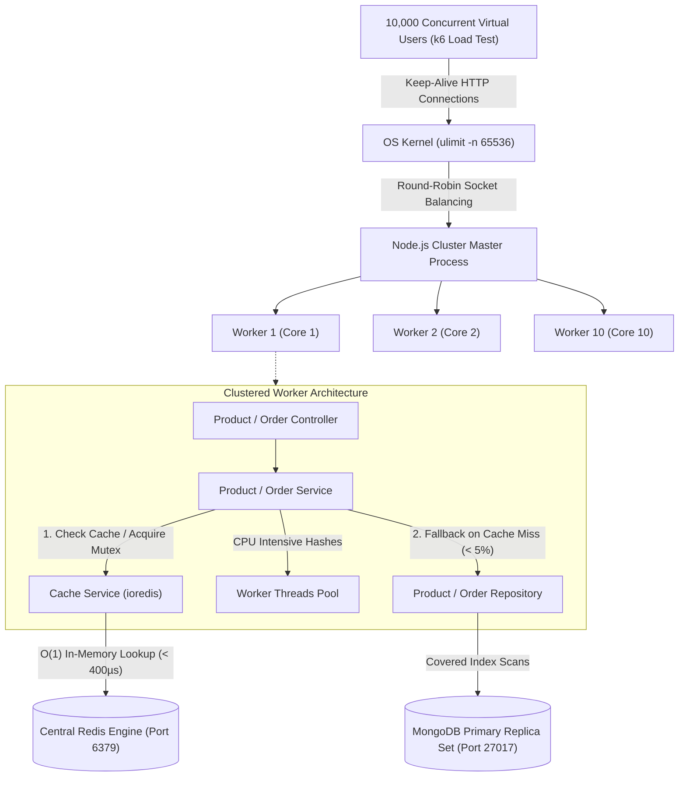

# ⚡ Phase 2: Ultra High-Throughput Node.js Backend with Distributed Redis Caching

Phase 2 builds upon the rock-solid database engineering of **v1** (which achieved 10,000 concurrent VUs with 0.00% error rate and 5.43ms p95 latency) by introducing **Redis** as a distributed in-memory caching and synchronization layer.

---

## 🎯 Architectural Mission of v2

While v1 proved that covered queries and multi-core clustering can handle 10k users directly on MongoDB, v2 unlocks **sub-millisecond latencies (< 400 µs)** and offloads **95%+ of query traffic** from MongoDB, reserving the primary database almost exclusively for orders, inventory deductions, and ACID transactions.

### Key Caching Problems Solved:
1. **Cache Stampede (Thundering Herd):** When hot cache keys expire, a **Distributed Mutex Lock (`SETNX`)** ensures only ONE request hits MongoDB to regenerate the cache, while thousands of concurrent requests wait and read the repopulated cache.
2. **Cache Avalanche:** TTLs are randomized with **TTL Jittering** (`baseTTL + Math.random() * jitter`) so mass key expirations never dump load simultaneously on MongoDB.
3. **Cache Penetration:** Queries for non-existent IDs cache a `null` sentinel with a short TTL (60s) so invalid requests never repeatedly hit MongoDB.
4. **Data Inconsistency:** Placing orders (`POST /api/orders`) triggers **transactional cache invalidation**, evicting affected product detail keys and catalog listings (`products:cat:*`) using non-blocking Redis `SCAN`.

---

## 🏛️ System Architecture



---

## 📁 Directory Structure

```
v2-with-redis/
├── .env                              # Environment variables (Port 5002, Redis, Mongo)
├── .env.example                      # Template environment variables
├── README.md                         # This file
├── docs/                             # Step-by-step implementation modules
│   ├── README.md                     # Documentation roadmap
│   ├── 01-redis-architecture-and-connection.md
│   ├── 02-caching-patterns-and-stampede-prevention.md
│   ├── 03-read-path-caching-and-catalog.md
│   ├── 04-write-path-cache-invalidation.md
│   ├── 05-multi-core-clustering-with-redis.md
│   └── 06-k6-load-testing-and-benchmarking.md
├── src/                              # Application source code (Module by Module)
│   ├── config/
│   │   ├── database.js               # MongoDB connection pool (from v1)
│   │   └── redis.js                  # Resilient ioredis client (Module 1)
│   ├── services/
│   │   ├── cache.service.js          # Cache-Aside, Stampede Lock, TTL Jitter (Module 2)
│   │   ├── product.service.js        # Read-path caching with diagnostics (Module 3)
│   │   └── order.service.js          # Write-path with cache invalidation (Module 4)
│   ├── repositories/
│   │   ├── product.repository.optimized.js # MongoDB covered index queries (fallback)
│   │   └── order.repository.js       # Atomic order placement
│   ├── controllers/
│   │   ├── product.controller.js     # Includes X-Cache: HIT / MISS headers
│   │   └── order.controller.js
│   ├── routes/
│   ├── models/
│   └── util/
├── cluster.js                        # Multi-core clustered entry point (Module 5)
├── server.js                         # Single-process development server
└── k6/
    └── redis-catalog-load-test.js    # 10k VU test with cache hit metrics (Module 6)
```

---

## ⚙️ Environment Variables (`.env`)

```env
# Server Configuration
PORT=5002
NODE_ENV=development

# MongoDB Connection String
MONGO_URI=mongodb://127.0.0.1:27017/scale_10k_db
MONGO_MIN_POOL_SIZE=10
MONGO_MAX_POOL_SIZE=50

# Redis In-Memory Cache & Mutex Lock Layer
REDIS_HOST=127.0.0.1
REDIS_PORT=6379
REDIS_PASSWORD=

# Caching Expiration Policies (seconds)
CACHE_TTL_CATALOG=120
CACHE_TTL_PRODUCT=600
CACHE_TTL_NULL=60
CACHE_JITTER_WINDOW=30
CACHE_LOCK_TTL=5
```

---

## 📊 Empirical Post-Mortems & Benchmark Reports

All empirical load test analyses, bottleneck postmortems, and Activity Monitor profiling logs are archived in [`bottlenecks/`](bottlenecks/):
1. 🚨 **[Baseline Load Test Failure Analysis](bottlenecks/baseline-failure-analysis/README.md):** Why the unindexed, single-core backend collapsed at 10k VUs (98.46% error rate, dial: i/o timeout).
2. 🔬 **[20k Concurrency & Ephemeral Port Exhaustion Report](bottlenecks/20k-concurrency-limits-analysis/README.md):** What happens when pushed past single-host limits (macOS 16,383 ephemeral port exhaustion & passive thermal throttling).
3. 🚀 **[15k Multi-Core Clustered Milestone Report](bottlenecks/15k-concurrency-clustering-analysis/README.md):** 1.51 Million requests handled across 10 CPU cores at 3,869 RPS with 1.2ms median latency.

---

## 📚 Step-by-Step Implementation Guides

Follow the 6 modular guides inside [`docs/`](docs/):

1. **[Module 1: Redis Architecture & Resilient Connection](docs/01-redis-architecture-and-connection.md)**
2. **[Module 2: Core Caching Service & Distributed Stampede Prevention](docs/02-caching-patterns-and-stampede-prevention.md)**
3. **[Module 3: Read-Path Caching (Catalog & Product Lookups)](docs/03-read-path-caching-and-catalog.md)**
4. **[Module 4: Write-Path Caching & Transactional Invalidation](docs/04-write-path-cache-invalidation.md)**
5. **[Module 5: Clustered Multi-Core Scaling with Redis](docs/05-multi-core-clustering-with-redis.md)**
6. **[Module 6: 10,000 VU k6 Load Testing & v1 vs v2 Benchmark](docs/06-k6-load-testing-and-benchmarking.md)**

---

## ⚡ Quick Start

### 1. Prerequisites
- **Node.js:** v18+ or v20+
- **MongoDB:** v6+ or v7+ (`brew services start mongodb-community@7.0`)
- **Redis:** v7+ (`brew services start redis`)
- **k6:** (`brew install k6`)

### 2. Verify Redis Connectivity
```bash
redis-cli ping
# Expected: PONG
```

### 3. Start Clustered Server
```bash
ulimit -n 65536
node cluster.js
```

### 4. Execute 10,000 VU Benchmark
```bash
k6 run k6/redis-catalog-load-test.js
```
