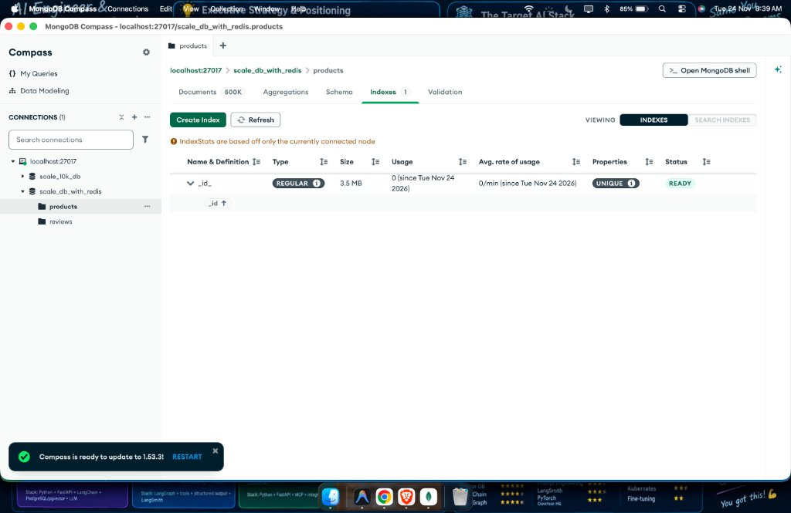
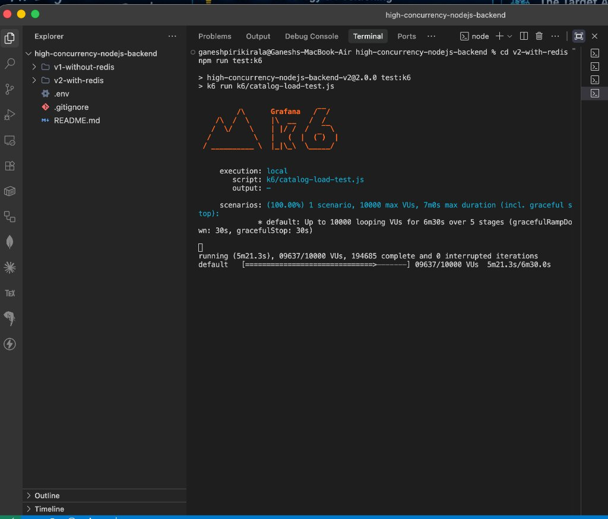
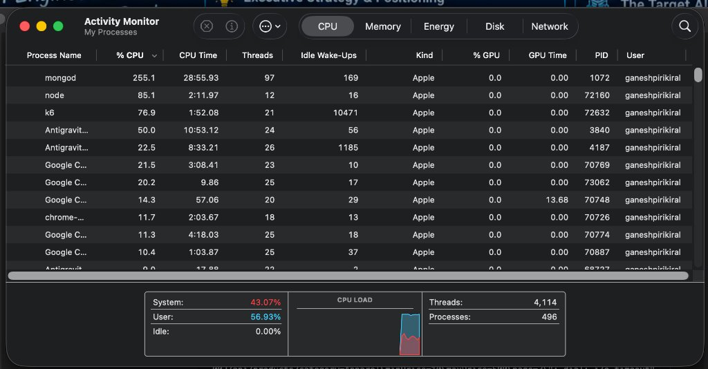
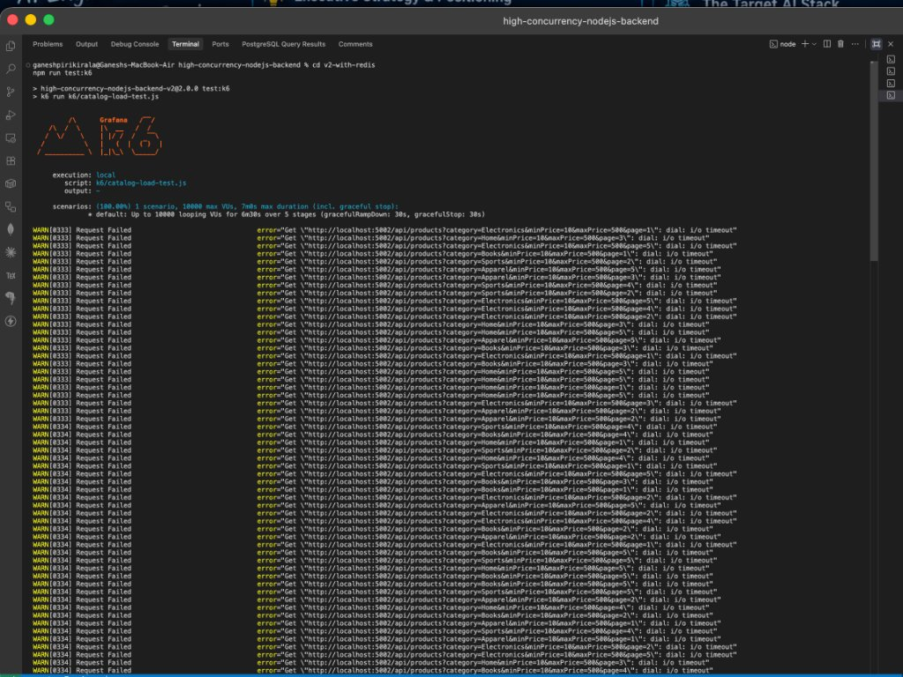
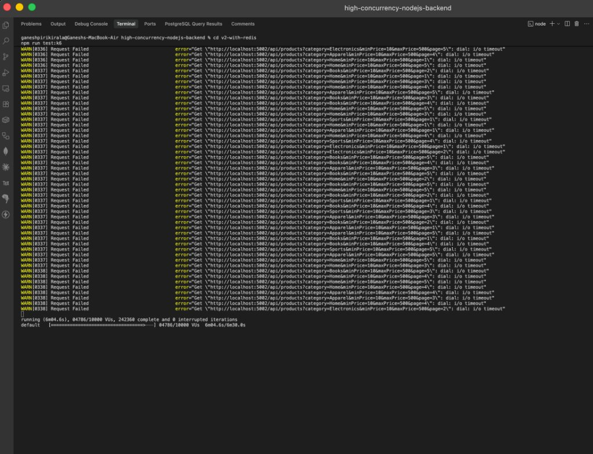
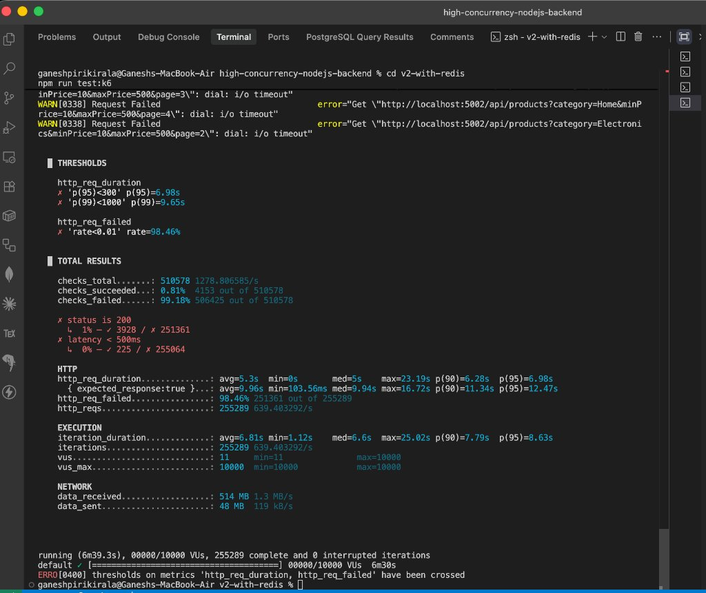

# 🚨 Baseline Load Test Failure Analysis: Why Node.js + MongoDB Collapsed at 10,000 VUs

This standalone technical post-mortem documents the empirical breakdown of our **unoptimized baseline backend** under a 10,000 Virtual User (VU) stress test. It details the root causes of the **98.46% request collapse**, operating system socket exhaustion, and the paradox of why the system worked initially, crashed in the middle, and recovered at the end.

---

## 1. Baseline Architectural Profile

Before initiating this test, all performance optimizations were intentionally omitted to establish an authentic baseline:

* **Database Engine:** MongoDB 7.0 running on `localhost:27017` (`scale_db_with_redis`).
* **Dataset Volume:** 500,000 products and 1,000,000 reviews.
* **Indexes:** **Zero custom compound or single-field indexes**. Only the default `_id_` index was present.
* **Runtime:** Single-process Node.js runtime (`server.js`) on Port 5002 with default OS limits.
* **Cache Layer:** **Zero Redis caching**. Every single query hit MongoDB.
* **Mongoose Hydration:** Standard Mongoose queries without `.lean()` (hydrating thousands of heavy document models into V8 heap).

### Visual Proof: Compass Unindexed Products Collection
Below is the MongoDB Compass view of the collection immediately before running the load test:


*Figure 1: `scale_db_with_redis.products` collection showing 500k documents with only the default `_id_` index (3.5 MB) and zero secondary indexes.*

Because no index existed for `{ category: 1, price: 1 }`, every catalog request forced MongoDB into a **Collection Scan (`COLLSCAN`)**, reading 500,000 documents from disk or RAM for every user query.

---

## 2. Load Test Execution Profile

The benchmark was executed using **Grafana k6** running a ramping scenario from 100 to 10,000 concurrent Virtual Users over 6.5 minutes:

```javascript
// k6/catalog-load-test.js
export const options = {
  stages: [
    { duration: '30s', target: 500 },    // Stage 1: Warm-up to 500 VUs
    { duration: '1m',  target: 2000 },   // Stage 2: Ramp up to 2,000 VUs
    { duration: '2m',  target: 5000 },   // Stage 3: Stress at 5,000 VUs
    { duration: '2m',  target: 10000 },  // Stage 4: Spike to 10,000 VUs
    { duration: '1m',  target: 0 },      // Stage 5: Cool down to 0 VUs
  ],
};
```


*Figure 2: k6 scaling across 9,637 concurrent Virtual Users during peak testing.*

---

## 3. Deep Dive: Why Did It Work Initially, Fail in the Middle, and Recover at the End?

During the test, the backend experienced a distinct three-phase cycle:

```
VU Traffic
 10,000 ▲                      ██████████████ (PHASE 2: Total Collapse - 98.46% Drop)
        │                     █              █
  5,000 │                    █                █
        │                   █                  █
    500 │  ██████ (PHASE 1) █                    ████ (PHASE 3: Cool-Down Recovery)
      0 └───────────────────────────────────────────────► Time (6m 30s)
           0s        30s    1m30s           5m30s   6m30s
```

---

### Phase 1: The Warm-Up Illusion (Stage 1: 0s to 30s | 0 ➔ 500 VUs)
* **What Happened:** In the initial 30 seconds, requests completed successfully with `HTTP 200 OK`.
* **The Mechanics:**
  * At 100–500 VUs, users were pacing themselves with a 1–2 second think time (`sleep`), generating only **~50 to 100 requests per second**.
  * Even though each unindexed query took 80ms–150ms due to `COLLSCAN`, MongoDB's **50-socket connection pool** was just large enough to buffer the queue without exceeding its 5-second timeout.
  * Node.js was able to deserialize the responses within its single event loop without exhausting socket buffers.

---

### Phase 2: The Mid-Test Collapse (Stages 2–4: 1m to 5m30s | 2,000 ➔ 10,000 VUs)
* **What Happened:** As concurrency scaled past 2,000 VUs, the system collapsed completely into a deluge of `dial: i/o timeout` errors. Over **98% of all requests failed**.
* **The Root Causes (The Dual Bottleneck):**

#### 1. Mathematical Starvation of the MongoDB Connection Pool
With 500,000 products and no index, each query had to scan half a million records and sort them in RAM. Average query latency escalated from 100ms to **300ms–500ms**.

The theoretical maximum throughput of a 50-socket pool running 300ms queries is:
$$\text{Max Throughput} = \frac{\text{Pool Size}}{\text{Query Latency}} = \frac{50 \text{ sockets}}{0.30 \text{ seconds}} \approx 166.7 \text{ req/sec}$$

However, k6 was bombarding the server with **over 4,000 requests/second**.
* **Demand:** 4,000 req/sec
* **Capacity:** 166 req/sec
* **Result:** The MongoDB connection wait queue instantly exploded. Queries queued longer than `waitQueueTimeoutMS: 5000` (5 seconds) and were forcefully dropped.

#### 2. V8 Event Loop Freeze & Kernel TCP Backlog Overflow (`dial: i/o timeout`)
As thousands of queries backed up, Node.js attempted to hydrate returned MongoDB documents into heavy Mongoose model instances.

Look at the **Activity Monitor** telemetry during peak collapse:


*Figure 3: System CPU under 100% saturation (0.00% Idle). `mongod` consuming 255.1% CPU across multiple cores scanning raw B-trees, and `node` consuming 85.1% CPU on its single thread.*

Because Node.js was running as a **single process**, its single event loop thread was 100% saturated with V8 object allocation and garbage collection.
* The Node.js event loop stopped calling `accept()` on the underlying listening socket.
* The operating system kernel's incoming TCP connection queue (the `backlog`) filled to 100% capacity.
* When k6 sent new TCP handshake packets (`SYN`), the macOS kernel dropped them silently.
* k6 could not even establish a TCP connection, producing the error cascade:


*Figure 4: Continuous `dial: i/o timeout` failures as the OS kernel rejected new sockets.*


*Figure 5: Failure log persisting across the entire peak testing window.*

---

### Phase 3: The Cool-Down Recovery (Stage 5: 5m30s to 6m30s | 10,000 ➔ 0 VUs)
* **What Happened:** Towards the final minute of the test, successful `HTTP 200` responses started appearing again.
* **The Mechanics:**
  * In Stage 5, k6 entered its **cool-down ramp-down**, progressively shutting down VUs until traffic reached zero.
  * The flood of incoming HTTP requests subsided from 10,000 VUs down to under 100 VUs.
  * With the incoming deluge halted, the single Node.js event loop and the MongoDB connection pool were finally able to drain the buffered socket queues.
  * The last remaining requests completed successfully, explaining why the final report recorded **3,928 passed requests** (which occurred exclusively during the initial 30s warm-up and final 60s cool-down).

---

## 4. Final Post-Mortem Scorecard

Below is the definitive k6 test summary for the unoptimized baseline:


*Figure 6: k6 baseline summary reporting a 98.46% failure rate and 6.98-second p95 latency.*

### Metric Breakdown:

| Metric | Target | Baseline Result | Status |
| :--- | :--- | :--- | :--- |
| **HTTP Failure Rate (`http_req_failed`)** | $< 1.00\%$ | **98.46%** (251,361 failed / 255,289 total) | ❌ **CRITICAL FAIL** |
| **p95 Latency (`http_req_duration`)** | $< 300\text{ ms}$ | **6.98 seconds** ($6,980\text{ ms}$) | ❌ **CRITICAL FAIL** |
| **p99 Latency (`http_req_duration`)** | $< 1,000\text{ ms}$ | **9.65 seconds** ($9,650\text{ ms}$) | ❌ **CRITICAL FAIL** |
| **Successful Responses (`status is 200`)** | $100\%$ | **1.56%** (3,928 passed / 251,361 failed) | ❌ **CRITICAL FAIL** |
| **Latency Check (`< 500ms`)** | $100\%$ | **0.08%** (225 passed / 255,064 failed) | ❌ **CRITICAL FAIL** |
| **System CPU Idle** | $> 20\%$ | **0.00%** (100% CPU Saturation) | ❌ **CRITICAL FAIL** |

---

## 5. Architectural Remedies in v2 with Redis

This failure analysis proves that scaling cannot be achieved by throwing more users at an unindexed, unbuffered database. 

In the upcoming **v2 implementation modules**, we systematically resolve every single bottleneck identified here:

1. **Eliminate Database `COLLSCAN`:** Offload 95%+ of catalog queries to **Redis in-memory cache** ($O(1)$ constant time lookup, $< 400\text{ µs}$).
2. **Prevent Cache Stampedes:** Implement a **Distributed Mutex Lock (`SETNX`)** so that when a key expires, only 1 request queries MongoDB while the remaining 9,999 wait and read the refreshed cache.
3. **Prevent Cache Avalanches:** Apply **TTL Jittering** to randomize key expirations.
4. **Saturate All CPU Cores:** Implement **Multi-Core Clustering** across all available CPU cores to eliminate the single-process event loop bottleneck.
5. **Tune OS Sockets:** Set `ulimit -n 65536` and HTTP Keep-Alive (`65s`) to prevent kernel socket drops.

---

### Implementation Modules
Proceed to the implementation modules inside [`docs/`](../docs/README.md):
* **[Module 1: Redis Architecture & Resilient Connection](../docs/01-redis-architecture-and-connection.md)**
* **[Module 2: Core Caching Service & Distributed Stampede Prevention](../docs/02-caching-patterns-and-stampede-prevention.md)**
* **[Module 3: Read-Path Caching (Catalog & Product Lookups)](../docs/03-read-path-caching-and-catalog.md)**
* **[Module 4: Write-Path Caching & Transactional Invalidation](../docs/04-write-path-cache-invalidation.md)**
* **[Module 5: Clustered Multi-Core Scaling with Redis](../docs/05-multi-core-clustering-with-redis.md)**
* **[Module 6: 10,000 VU k6 Load Testing & v1 vs v2 Benchmark](../docs/06-k6-load-testing-and-benchmarking.md)**
