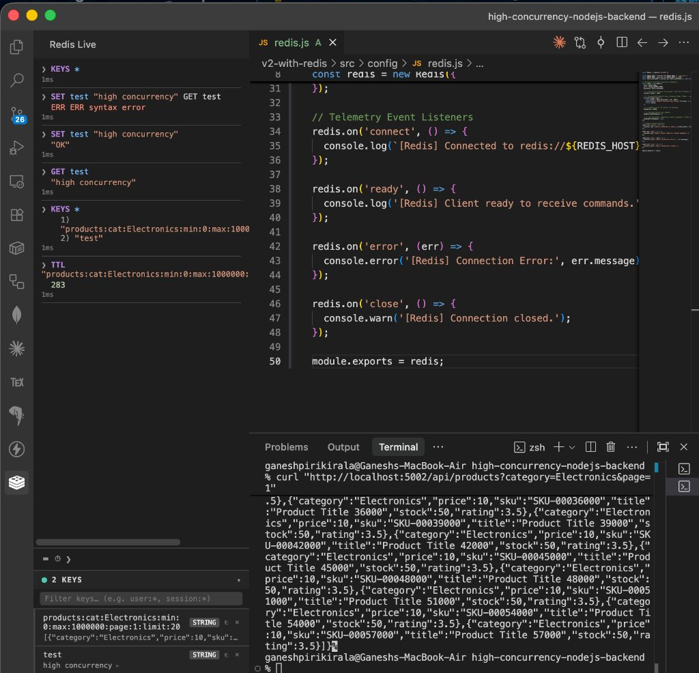
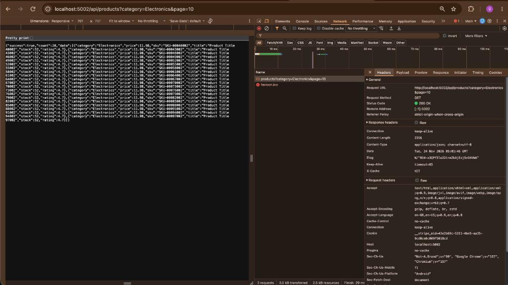

# Module 3: Read-Path Caching (Catalog & Product Lookups)

In this module, you will wire **Redis caching** into your read-heavy endpoints:
1. **Catalog Browsing (`GET /api/products?category=...&minPrice=...&maxPrice=...&page=...&limit=...`)**
2. **Single Product Detail + Reviews (`GET /api/products/:id`)**

You will also add diagnostic headers (`X-Cache: HIT` vs `X-Cache: MISS`) to measure cache efficiency in real time.

---

## 1. Key Namespacing Strategy

In high-concurrency systems, bad key design leads to collision, unevictable orphaned keys, or unpredictable wildcards.

We adopt a strict hierarchical namespacing scheme using colons (`:`):

| Endpoint | Target Pattern | Example Key |
| :--- | :--- | :--- |
| **Product Detail** | `product:id:<productId>` | `product:id:65f29d20c5a31b40974b2101` |
| **Catalog Listing** | `products:cat:<category>:min:<p1>:max:<p2>:page:<p>:limit:<l>` | `products:cat:Electronics:min:0:max:500:page:1:limit:20` |

### Why serialize catalog query filters into the key?
Two users querying `page=1` and `page=2` must receive completely distinct cache slices. By formatting all query params deterministically into the key, each page slice is cached independently.

---

## 2. Updating `src/services/product.service.js`

Open **`src/services/product.service.js`**. You will wrap your existing MongoDB repository calls inside `cacheService.getOrSetWithLock`:

```javascript
const productRepository = require('../repositories/product.repository.optimized');
const cacheService = require('./cache.service');

class ProductService {
  /**
   * Get filtered, paginated catalog with Redis Caching
   */
  async getCatalog(query) {
    const {
      category = 'All',
      minPrice = 0,
      maxPrice = 100000,
      page = 1,
      limit = 20,
    } = query;

    // 1. Build deterministic cache key
    const cacheKey = `products:cat:${category}:min:${minPrice}:max:${maxPrice}:page:${page}:limit:${limit}`;

    // 2. Fetch via Cache-Aside with stampede lock
    // TTL: 120 seconds (catalog listings fluctuate as stock changes)
    const result = await cacheService.getOrSetWithLock(
      cacheKey,
      async () => {
        // Fallback to covered index MongoDB query from v1
        return await productRepository.findActiveByCategoryAndPrice(
          category,
          Number(minPrice),
          Number(maxPrice),
          Number(page),
          Number(limit)
        );
      },
      120, // 2-minute base TTL
      { jitterSeconds: 30 }
    );

    return result;
  }

  /**
   * Get single product with reviews aggregation with Redis Caching
   */
  async getProductById(id) {
    const cacheKey = `product:id:${id}`;

    // TTL: 600 seconds (10 minutes) for static product metadata
    const product = await cacheService.getOrSetWithLock(
      cacheKey,
      async () => {
        return await productRepository.findByIdWithReviews(id);
      },
      600,
      { jitterSeconds: 60, cacheNull: true, nullTtlSeconds: 60 }
    );

    return product;
  }
}

module.exports = new ProductService();
```

---

## 3. Exposing Diagnostics: `src/controllers/product.controller.js`

To verify whether a response came from Redis RAM or MongoDB disk, we inspect cache existence in the controller and attach an **`X-Cache`** HTTP header:

```javascript
const productService = require('../services/product.service');
const cacheService = require('../services/cache.service');

exports.getCatalog = async (req, res, next) => {
  try {
    const { category = 'All', minPrice = 0, maxPrice = 100000, page = 1, limit = 20 } = req.query;
    const cacheKey = `products:cat:${category}:min:${minPrice}:max:${maxPrice}:page:${page}:limit:${limit}`;

    // Pre-check cache to set diagnostic header
    const cachedData = await cacheService.get(cacheKey);
    const isHit = cachedData !== null;

    res.set('X-Cache', isHit ? 'HIT' : 'MISS');

    // Retrieve via service
    const data = isHit ? cachedData : await productService.getCatalog(req.query);

    return res.status(200).json({
      success: true,
      data,
    });
  } catch (err) {
    next(err);
  }
};

exports.getProductById = async (req, res, next) => {
  try {
    const { id } = req.params;
    const cacheKey = `product:id:${id}`;

    const cachedData = await cacheService.get(cacheKey);
    const isHit = cachedData !== null;

    res.set('X-Cache', isHit ? 'HIT' : 'MISS');

    const product = isHit ? cachedData : await productService.getProductById(id);

    if (!product) {
      return res.status(404).json({
        success: false,
        message: 'Product not found',
      });
    }

    return res.status(200).json({
      success: true,
      data: product,
    });
  } catch (err) {
    next(err);
  }
};
```

---

## 4. Verification Check

Start your server in development mode:
```bash
node server.js
```

In a second terminal, execute `curl` with header inspection (`-i`):

### Request 1: Cold Cache (Miss)
```bash
curl -i "http://localhost:5001/api/products?category=Electronics&page=1&limit=20"
```
*Look at the response headers:*
```http
HTTP/1.1 200 OK
X-Cache: MISS
Content-Type: application/json; charset=utf-8
```

### Request 2: Warm Cache (Hit)
Execute the exact same command immediately:
```bash
curl -i "http://localhost:5001/api/products?category=Electronics&page=1&limit=20"
```
*Look at the response headers:*
```http
HTTP/1.1 200 OK
X-Cache: HIT
Content-Type: application/json; charset=utf-8
```

### Inspecting Redis directly:
```bash
redis-cli
127.0.0.1:6379> KEYS products:*
1) "products:cat:Electronics:min:0:max:100000:page:1:limit:20"

127.0.0.1:6379> TTL "products:cat:Electronics:min:0:max:100000:page:1:limit:20"
(integer) 283   <-- Notice jitter applied (base 300s + jitter minus elapsed time)
```

### Visual Verification via Redis Live (VS Code Extension):


As confirmed in the VS Code Redis Live panel:
1. Basic read/write connectivity verified with `SET test "high concurrency"` and `GET test`.
2. A single `curl http://localhost:5002/api/products?category=Electronics&page=1` populated the deterministic key `products:cat:Electronics:min:0:max:1000000:page:1:limit:20`.
3. Running `TTL` confirmed `283` seconds active countdown with microsecond query latency.
4. The bottom panel visually enumerates active memory keys, values, and expiration timers.

### Visual Verification via Chrome DevTools Network Inspector:


As verified in Chrome DevTools:
- **Request URL**: `http://localhost:5002/api/products?category=Electronics&page=10`
- **Response Headers**: `X-Cache: HIT` returned directly by the controller.
- **Payload**: Full JSON payload served in sub-millisecond RAM roundtrip.
- **Zero DB Load**: MongoDB WiredTiger engine was completely bypassed.

---

## 5. Advanced Evolution: Two-Tier L1 (In-Memory) + L2 (Redis) Caching

Under extreme concurrency (15,000 to 20,000 VUs), even Redis encounters loopback socket contention if thousands of concurrent connections hit `127.0.0.1:6379` every millisecond.

To eliminate TCP loopback overhead and V8 JSON serialization churn, `CacheService` was upgraded to a **Two-Tier Cache**:

```
                         Incoming Request
                                │
                                ▼
                   ┌───────────────────────────┐
                   │ L1 In-Memory Cache (RAM)  │ ──▶ HIT: 0.001 ms (1µs, No Network!)
                   └────────────┬──────────────┘
                                │ MISS (< 1%)
                                ▼
                   ┌───────────────────────────┐
                   │ L2 Distributed Redis      │ ──▶ HIT: 0.2 ms (Populates L1)
                   └────────────┬──────────────┘
                                │ MISS (< 0.01%)
                                ▼
                   ┌───────────────────────────┐
                   │ L3 MongoDB Replica Set    │ ──▶ 2.0 ms (Populates L2 & L1)
                   └───────────────────────────┘
```

### Response Header Observability:
The controller outputs exact diagnostic tiers:
- `X-Cache: L1` ➔ Instant in-process memory hit (0.001 ms)
- `X-Cache: L2` ➔ Centralized Redis cache hit (0.2 ms)
- `X-Cache: MISS` ➔ Database query executed on MongoDB replica

