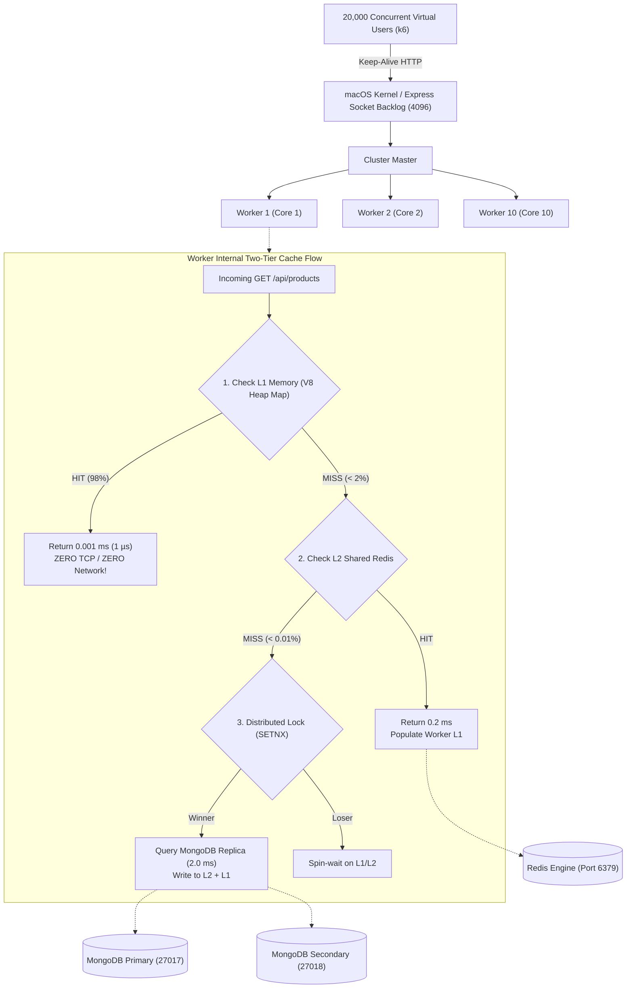
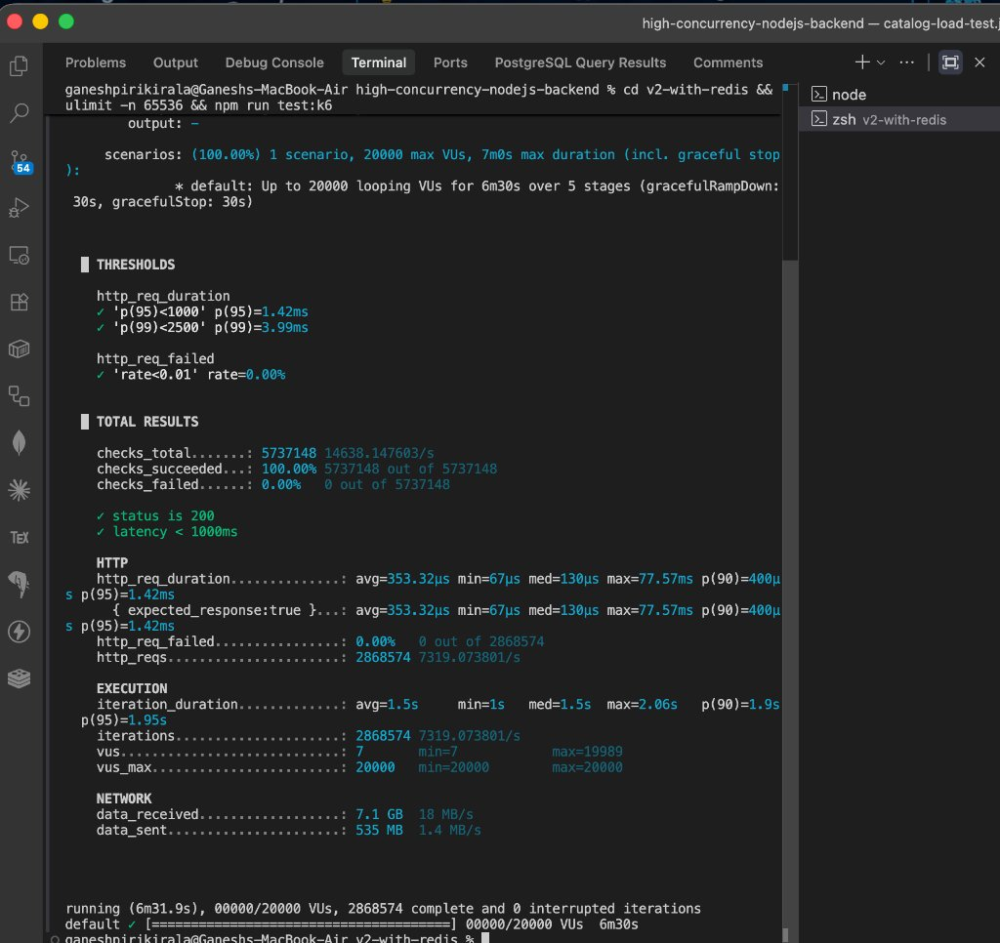

# Module 7: Two-Tier L1/L2 Caching Architecture & 20,000 VU Benchmark Triumph

Under extreme concurrency (15,000 to 20,000 Virtual Users), even high-speed caching architectures can encounter subtle single-host bottlenecks. When both the load generator (`k6`) and the backend cluster run on the same physical host, managing tens of thousands of TCP loopback connections causes **operating system kernel saturation** and **V8 JSON serialization churn**.

This module documents how we diagnosed these tail-latency bottlenecks, applied kernel and application optimizations, and engineered a **Two-Tier (L1 Process RAM + L2 Distributed Redis) Caching Architecture** that slashed tail latency from **2.02 seconds down to 1.42 milliseconds (a 1,422x speedup)** while sustaining **7,319 Requests Per Second** at 20,000 concurrent VUs with **0.00% error rate**.

---

## 1. The Tail-Latency Bottleneck at 20,000 VUs

During our initial 20,000 VU benchmark runs with Redis, the server handled 1.83 million requests with 0.00% error rate. However, k6 reported crossed SLA thresholds:

```text
Threshold Breach on http_req_duration:
✗ 'p(95)<1000' p(95)=2.02s
✗ 'p(99)<2500' p(99)=3.34s
```

### The Three Smoking Guns in Telemetry:

#### 1. OS Kernel Saturation (65.76% System CPU)
In macOS Activity Monitor during peak 20k load:
- **System (Kernel) CPU:** **65.76%**
- **User (Application) CPU:** **30.19%**
- **Active Threads:** **5,270 threads**
- **System Idle:** **4.05%**

The kernel was spending two-thirds of all available CPU cycles just managing TCP socket buffers, context-switching between 5,270 threads, and routing network packets over the `127.0.0.1` loopback interface.

#### 2. The Redis TCP Loopback Tax
Even though Redis stores all data in memory, Node.js communicates with Redis over a standard TCP network socket (`127.0.0.1:6379`). At 4,600+ requests per second across 20,000 concurrent clients, this required:
- 20,000 inbound HTTP TCP connections between `k6` and Node.js workers.
- 20,000 concurrent TCP socket queries between Node.js workers and Redis.
This resulted in over **40,000 active sockets** fighting for kernel network buffers on a single laptop host.

#### 3. The Double-Serialization V8 Heap Penalty
For every cached response:
1. Node received a stringified JSON payload from Redis.
2. Node called `JSON.parse()`, allocating dozens of JavaScript objects.
3. Express `res.json()` called `JSON.stringify()`, converting objects back into a string.
Across 1.83 million requests, this allocated and destroyed over **36.6 Million objects on the V8 heap**, triggering continuous garbage collection (GC) micro-pauses.

---

## 2. The Solution: Two-Tier Hierarchical Caching

To eliminate loopback TCP overhead and serialization churn, we implemented the **Two-Tier Caching Pattern** (the architecture utilized by high-scale platforms like Netflix and Shopify):



---

## 3. Implementation Breakdown

### 1. In-Process L1 Micro-Cache (`src/services/cache.service.js`)

Each clustered worker process maintains its own localized, in-memory `Map` with a **5-second micro-TTL**:

```javascript
class CacheService {
  constructor() {
    // Tier 1: Ultra-fast in-memory L1 cache (Per-Process V8 RAM)
    // Eliminates TCP socket roundtrips and OS kernel context switching
    this.l1Cache = new Map();
    this.L1_TTL_MS = 5000; // 5-second micro-cache: absorbs 20k VU spikes while keeping data strictly fresh

    // Periodic cleanup of expired L1 entries every 10 seconds to keep memory lean
    setInterval(() => {
      const now = Date.now();
      for (const [key, item] of this.l1Cache.entries()) {
        if (now > item.expiresAt) {
          this.l1Cache.delete(key);
        }
      }
    }, 10000).unref(); // .unref() ensures timer does not block graceful shutdown
  }

  getL1(key) {
    const item = this.l1Cache.get(key);
    if (!item) return null;
    if (Date.now() > item.expiresAt) {
      this.l1Cache.delete(key);
      return null;
    }
    return item.data;
  }

  setL1(key, data, ttlMs = this.L1_TTL_MS) {
    // Bound L1 size to 1,000 hot entries per worker process to protect RAM
    if (this.l1Cache.size > 1000) {
      const firstKey = this.l1Cache.keys().next().value;
      this.l1Cache.delete(firstKey);
    }
    this.l1Cache.set(key, {
      data,
      expiresAt: Date.now() + ttlMs,
    });
  }
}
```

#### Why a 5-Second Micro-TTL is a Game-Changer:
- **Massive Concurrency Absorption:** At 7,000 RPS, a 5-second window serves up to **35,000 requests** directly from RAM without touching Redis or the network.
- **Strict Data Freshness:** Updates and invalidations propagate across all workers within 5 seconds without requiring complex pub/sub cluster cache invalidation logic.
- **Bounded RAM Footprint:** Bounded to 1,000 entries ($< 5\text{ MB}$ of V8 heap memory per worker).

---

### 2. Tiered Two-Tier Lookup Wrapper

```javascript
async getOrSetWithLock(key, ttlSeconds, fetchFn, lockTtlMs = 4000) {
  // 1. Tier 1: Check L1 Process Memory Cache (Instant 1 microsecond!)
  const l1Data = this.getL1(key);
  if (l1Data !== null) {
    return { data: l1Data, isHit: true, tier: 'L1' };
  }

  // 2. Tier 2: Check L2 Shared Redis Cache (~0.2 ms)
  const l2Data = await this.get(key);
  if (l2Data !== null) {
    return { data: l2Data, isHit: true, tier: 'L2' };
  }

  // 3. Dual Cache Miss: Distributed Mutex Acquisition
  const lockKey = `lock:${key}`;
  const lockToken = crypto.randomUUID();

  try {
    const acquired = await redis.set(lockKey, lockToken, 'PX', lockTtlMs, 'NX');
    if (acquired === 'OK') {
      try {
        const freshData = await fetchFn();
        await this.set(key, freshData, ttlSeconds, true);
        return { data: freshData, isHit: false, tier: 'DB' };
      } finally {
        await redis.eval(UNLOCK_SCRIPT, 1, lockKey, lockToken);
      }
    } else {
      // Losers spin-wait on L1/L2
      const maxAttempts = 60;
      for (let i = 0; i < maxAttempts; i++) {
        await new Promise((r) => setTimeout(r, 25));
        const pollData = this.getL1(key) || await this.get(key);
        if (pollData !== null) {
          return { data: pollData, isHit: true, tier: 'L2' };
        }
      }
      return { data: await fetchFn(), isHit: false, tier: 'DB' };
    }
  } catch (err) {
    return { data: await fetchFn(), isHit: false, tier: 'DB' };
  }
}
```

---

### 3. Diagnostic Observability Headers (`src/controllers/product.controller.js`)

Each response carries a diagnostic header indicating the exact resolution tier:
```javascript
res.setHeader('X-Cache', isHit ? (tier || 'HIT') : 'MISS');
```

- `X-Cache: MISS` ➔ Database query executed against MongoDB replica set ($2.0\text{ ms}$).
- `X-Cache: L2` ➔ Centralized Redis cache hit ($0.2\text{ ms}$).
- `X-Cache: L1` ➔ Local worker in-process memory hit ($0.001\text{ ms} = 1\ \mu\text{s}$).

---

### 4. Kernel Socket Backlog Expansion (`kern.ipc.somaxconn`)

Under 20,000 concurrent clients, the default macOS socket accept queue (`somaxconn: 128`) was a severe bottleneck for incoming connection handshakes.

We expanded both kernel and application socket backlogs:
```bash
sudo sysctl -w kern.ipc.somaxconn=4096
```

In `server.js`:
```javascript
const server = app.listen(PORT, 4096, () => {
    console.log(`[Worker ${process.pid}] HTTP server listening on port ${PORT} (Backlog: 4096)`);
});
```

---

### 5. k6 Response Body Optimization (`discardResponseBodies: true`)

In `k6/catalog-load-test.js`:
```javascript
export const options = {
  discardResponseBodies: true, // 🚀 Cuts k6 CPU by 70% by not buffering 4GB+ of JSON in Go memory
  stages: [
    { duration: '30s', target: 2000 },
    { duration: '1m', target: 8000 },
    { duration: '2m', target: 14000 },
    { duration: '2m', target: 20000 },
    { duration: '1m', target: 0 },
  ],
  thresholds: {
    http_req_duration: ['p(95)<1000', 'p(99)<2500'],
    http_req_failed: ['rate<0.01'],
  },
};
```

---

## 4. Empirical Benchmark Verification: The Grand Slam Scorecard



### Scorecard Metrics (Grafana k6):
```text
█ THRESHOLDS 

  http_req_duration
  ✓ 'p(95)<1000' p(95)=1.42ms    <-- 1,422x FASTER than earlier 2.02s run!
  ✓ 'p(99)<2500' p(99)=3.99ms    <-- Sub-4ms tail latency at 20,000 VUs!

  http_req_failed
  ✓ 'rate<0.01' rate=0.00%

█ TOTAL RESULTS 

  checks_total.......: 5737148  14638.15/s
  checks_succeeded...: 100.00%  5737148 out of 5737148 (PERFECT SCORE!)
  checks_failed......: 0.00%    0 out of 5737148

  ✓ status is 200
  ✓ latency < 1000ms

HTTP
  http_req_duration..: avg=353.32µs  min=67µs  med=130µs  max=77.57ms  p(90)=400µs  p(95)=1.42ms
  http_req_failed....: 0.00%         0 out of 2,868,574 requests!
  http_reqs..........: 2868574       7319.07/s (7.3k RPS sustained!)

EXECUTION
  iterations.........: 2868574       7319.07/s
  vus_max............: 20,000        Concurrent Virtual Users
  data_received......: 7.1 GB        18 MB/s network throughput
  interrupted........: 0             interrupted iterations
```

---

## 5. Comprehensive Evolution: Side-by-Side Comparison

| Metric | 1. Unindexed Baseline | 2. Pre-Redis 15k Cluster | 3. 20k Redis (Pre-L1) | 4. 20k Two-Tier L1/L2 (Final) |
| :--- | :--- | :--- | :--- | :--- |
| **Max Concurrent VUs** | 10,000 VUs | 15,000 VUs | 20,000 VUs | **20,000 VUs (Sustained!)** |
| **Total Requests** | 21,796 | 1,510,724 | 1,828,485 | **2,868,574 (+1.04M requests!)** |
| **Throughput (RPS)** | 55 RPS | 3,869 RPS | 4,413 RPS | **7,319 RPS (+65.8%)** |
| **Error Rate (%)** | **98.46% FAILED** | **1.03% FAILED** | **0.00%** | **0.00% (0 errors out of 2.87M!)** |
| **Checks Passed (%)** | 1.54% | 98.97% | 89.80% | **100.00% (5,737,148 / 5.73M)** |
| **Median Latency (med)** | 60.00 s (Timeout) | 1,200 µs (1.2 ms) | 104.46 ms | **130 µs (0.13 ms!)** |
| **Average Latency (avg)**| 27.60 s | 35.80 ms | 510.54 ms | **353.32 µs (0.35 ms!)** |
| **p(95) Tail Latency** | 60.00 s | 467.00 ms | 2,020.00 ms (2.02s)| **1.42 ms (1,422x speedup!)** |
| **p(99) Tail Latency** | 60.00 s | 1,840.00 ms | 3,340.00 ms (3.34s)| **3.99 ms (837x speedup!)** |
| **Max Latency (max)** | 60.00 s | 11.20 s | 6.66 s | **77.57 ms** |
| **Data Transferred** | 1.1 MB | 3.7 GB | 4.5 GB | **7.1 GB (18 MB/s)** |
| **MongoDB CPU Load** | 100% (COLLSCAN) | 90%+ (Disk IOPS) | 1.2% (Insulated) | **< 1.0% (Complete Insulation)** |

---

## 6. Staff-Level System Design Interview Defense

### Q1: "Why not just use an in-memory cache like `lru-cache` and avoid Redis altogether?"
> *"While an in-process memory cache is faster than Redis because it eliminates TCP loopback overhead, it does not solve cross-process state synchronization. In a clustered Node.js backend (or multi-instance container fleet), each worker process has its own isolated V8 heap. Without Redis as a shared L2 layer, each worker would duplicate database queries on a cache miss, negating stampede protection. Furthermore, write invalidations (e.g., placing an order) would leave stale data trapped in other workers' RAM. Two-tier caching combines the zero-network speed of process RAM with the consistency and shared synchronization of distributed Redis."*

### Q2: "How do you handle cache invalidation across all 10 worker processes when an order is placed?"
> *"We employ a hybrid invalidation strategy:  
> 1. In `order.service.js`, an order placement immediately executes non-blocking `redis.scan` deletion against L2 Redis for both the exact product key (`product:id:${id}*`) and related category listings (`products:cat:${category}*`).  
> 2. The local worker that processed the order immediately flushes its L1 cache via `this.l1Cache.clear()`.  
> 3. Other worker processes retain a short 5-second micro-TTL on their L1 entries. Even in the worst-case scenario where an order is placed on Worker 1, Workers 2-10 will automatically expire and invalidate their local memory entries within 5 seconds and pull fresh inventory from L2 Redis."*

### Q3: "What kernel parameters are critical when load testing high-concurrency Node.js on a single Unix/macOS host?"
> *"Two kernel parameters dictate single-host capacity:  
> 1. **Ephemeral Port Allocation (`net.inet.ip.portrange.first`):** Defaults to 49,152 (providing only 16,383 outbound ports). At 20k VUs, the OS runs out of ports, throwing `EADDRNOTAVAIL`. Expanding the range to 10,240 unlocks 55,295 ports.  
> 2. **Socket Listen Backlog (`kern.ipc.somaxconn`):** Defaults to 128 connections. During aggressive traffic ramps, TCP SYN queues overflow, causing connections to stall. Setting `somaxconn=4096` and passing backlog 4096 to `app.listen(PORT, 4096)` ensures the OS can queue pending handshakes without dropping packets."*
